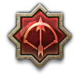
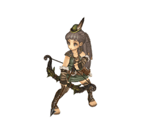
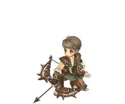

# Archer · Arqueiro

[Classes](README.md) · [Anterior: Wizard](wizard.md) · [Próxima: Cleric](cleric.md)

| Visual feminino | Visual masculino |
| :---: | :---: |
|  |  |

*Imagens originais da IMC Games, obtidas no site oficial atual. A aparência exata desses arquivos em 2016 ainda precisa de comprovação. [Procedência](../imagens.md).*

## Identidade no lançamento

Classe inicial de combate à distância. O guia de bruno.c.caetano descreve o uso das habilidades para caçar e enfrentar chefes, assim como as opções adicionais ao repetir círculos. O texto contém recomendações pessoais e revisões: esta ficha preserva a identificação das ferramentas, sem reproduzir notas de força ou recomendar uma distribuição obrigatória de atributos. [F04](../fontes.md#f04)

## Habilidades por círculo

| Desbloqueio | Habilidade | Função histórica resumida |
| --- | --- | --- |
| C1 | Swift Step | Buff ligado à mobilidade e evasão. |
| C1 | Multi Shot | Sequência de disparos com carregamento. |
| C1 | Full Draw | Disparo com utilidade de controle. |
| C1 | Oblique Shot | Disparo usado na progressão inicial. |
| C2 | Kneeling Shot | Postura de tiro sem movimentação. |
| C2 | Heavy Shot | Disparo adicional disponível no segundo círculo. |
| C3 | Twin Arrows | Ataque de duas flechas do terceiro círculo. |

**Evidência:** C1/C2 e discussão de C3 no guia e seus comentários do período. A página possui revisões; a data de criação não certifica o estado de cada linha no primeiro dia. [F04](../fontes.md#f04)

## O que falta preservar

- Condições exatas de mobilidade do Swift Step e seus atributos.
- Arcos, bestas, secundárias e restrições por habilidade.
- Recargas, carregamento, alcance e custos de cada nível.
- Mestre, missão de avanço e diferenças do beta.

**Leitura para o futuro solo:** mobilidade, consumo de SP e duração das lutas são pautas para testes posteriores. Nenhum ajuste solo foi incorporado aos dados históricos desta página.
