# Catálogo de classes · O panorama de 2016

[Início](../../README.md) · [Classes iniciais](README.md) · [Diretrizes da versão solo](../projeto-solo/diretrizes.md)

**55 classes · 382 habilidades resumidas · 165 imagens originais.** Um passeio pelas quatro árvores e pelo que cada especialização fazia, antes de aprofundar os números.

A adaptação solo removerá classes mágicas. Este catálogo reúne o original como referência; aparecer aqui não significa inclusão na versão solo. O tratamento nominal de classes híbridas ainda está aberto.

## Qual versão está aqui?

O recorte é a janela internacional de março–abril de 2016, até Rank 7. São 52 classes regulares e três ocultas: Shinobi, Rune Caster e Chaplain. A lista cruza a visão geral, fichas arquivadas e o relato contemporâneo sobre ocultas. [F37](../fontes.md#f37) · [F94](../fontes.md#f94)

O banco também tinha classes planejadas. Por isso, Centurion, Appraiser, Mimic, Shepherd e classes de expansões posteriores não foram promovidas a opções do lançamento só por terem uma página. Rank 8 pertence a uma expansão posterior. [F95](../fontes.md#f95)

Os círculos estão limitados ao que cabe até Rank 7: uma classe de Rank 6 aparece até C2 e uma de Rank 7 até C1. As ocultas aparecem em C1. Scout pertence à árvore Archer deste recorte, e não é uma quinta classe inicial.

**Imagens:** emblemas e sprites originais da IMC, copiados do site oficial atual; a correspondência exata desses arquivos com 2016 ainda precisa de prova. As habilidades vêm das páginas arquivadas, sem importar o kit moderno. [Procedência](../imagens.md).

## Explore as árvores

Cada ficha reúne os dois visuais, a identidade da classe e todas as habilidades listadas no recorte, com uma frase sobre cada função. Números, atributos detalhados, missões e compatibilidade completa de armas continuam para a etapa de aprofundamento.

## Swordsman · 14 classes

| Classe | Rank | O que fazia | Habilidades |
| --- | --- | --- | --- |
| [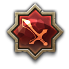 Swordsman](catalogo/swordsman.md) | 1 | Base de combate próximo, com golpes simples, reforços de ataque e resistência a interrupções. | 8 |
| [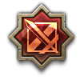 Highlander](catalogo/highlander.md) | 2 | Espadachim que combina cortes, sangramento e enfraquecimento da defesa para preparar novos ataques. | 9 |
| [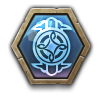 Peltasta](catalogo/peltasta.md) | 2 | Especialista em escudo, provocação e bloqueio, capaz de reunir inimigos e proteger sua posição. | 9 |
| [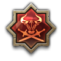 Barbarian](catalogo/barbarian.md) | 3 | Combatente agressivo que acumula força, atordoa e avança com ataques de grande impacto. | 9 |
| [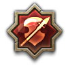 Hoplite](catalogo/hoplite.md) | 3 | Lanceiro de estocadas e postura crítica, com ataques que exploram o tamanho e a vulnerabilidade do alvo. | 7 |
| [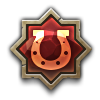 Cataphract](catalogo/cataphract.md) | 4 | Lanceiro montado que combina mobilidade, investidas e ataques durante deslocamento. | 6 |
| [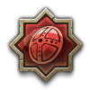 Rodelero](catalogo/rodelero.md) | 4 | Lutador de escudo que interrompe, desloca e enfraquece adversários com controle próximo. | 9 |
| [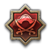 Corsair](catalogo/corsair.md) | 5 | Pirata de gancho, pilhagem e duas armas, com sequências de adaga e acesso posterior à pistola. | 8 |
| [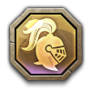 Squire](catalogo/squire.md) | 5 | Ofício de manutenção e apoio: reparos, melhorias temporárias, acampamento e refeições para o grupo. | 7 |
| [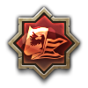 Doppelsoeldner](catalogo/doppelsoeldner.md) | 6 | Atacante de espada que aceita mais risco para aumentar pressão ofensiva e executar ataques giratórios. | 8 |
| [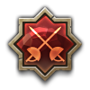 Fencer](catalogo/fencer.md) | 6 | Duelista de rapieira, com estocadas rápidas, esquivas, aparos e exposição do adversário. | 7 |
| [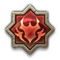 Dragoon](catalogo/dragoon.md) | 7 | Lanceiro de ataques poderosos, arremessos e golpes ascendentes contra grupos ou alvos resistentes. | 4 |
| [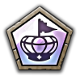 Templar](catalogo/templar.md) | 7 | Classe voltada à liderança de guilda, com transporte de membros, torre e reforços coletivos. | 5 |
| [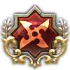 Shinobi · oculta](catalogo/shinobi.md) | 7 | Classe oculta de kunais, clones, contra-ataques e explosões; reúne combate físico e técnicas sobrenaturais. | 5 |

## Wizard · 14 classes

| Classe | Rank | O que fazia | Habilidades |
| --- | --- | --- | --- |
| [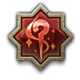 Wizard](catalogo/wizard.md) | 1 | Base de magia, proteção e controle, com opções posteriores para acelerar ou sustentar a conjuração. | 8 |
| [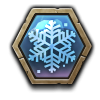 Cryomancer](catalogo/cryomancer.md) | 2 | Mago de gelo focado em congelamento, paredes e agrupamento de inimigos. | 8 |
| [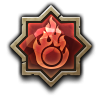 Pyromancer](catalogo/pyromancer.md) | 2 | Mago de fogo que cria áreas persistentes, barreiras flamejantes e reforços de ataque. | 7 |
| [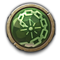 Linker](catalogo/linker.md) | 3 | Especialista em conexões que compartilha dano entre inimigos e efeitos entre aliados. | 6 |
| [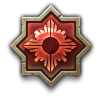 Psychokino](catalogo/psychokino.md) | 3 | Controlador de psicocinese que move, suspende e concentra inimigos para causar dano. | 7 |
| [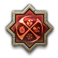 Elementalist](catalogo/elementalist.md) | 4 | Conjurador ofensivo que combina relâmpagos, gelo, fogo e grandes áreas de dano. | 8 |
| [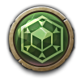 Thaumaturge](catalogo/thaumaturge.md) | 4 | Manipula tamanho e atributos de corpos, alterando ataque, resistência e recompensas dos monstros. | 7 |
| [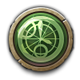 Chronomancer](catalogo/chronomancer.md) | 5 | Suporte temporal que altera velocidade, recargas e estados anteriores do campo. | 7 |
| [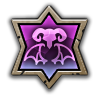 Sorcerer](catalogo/sorcerer.md) | 5 | Invocador de demônios por cartas, com comandos, montaria e controle de suas criaturas. | 10 |
| [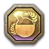 Alchemist](catalogo/alchemist.md) | 6 | Ofício de alquimia: poções, combinações, despertar de itens e tratamento de gemas. | 7 |
| [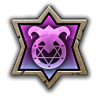 Necromancer](catalogo/necromancer.md) | 6 | Usa cadáveres como recurso para criaturas, esqueletos, torres e ataques de restos mortais. | 8 |
| [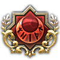 Rune Caster · oculta](catalogo/rune-caster.md) | 6 | Classe oculta de runas que reúne grandes ataques, fortalecimento elemental e transformação em gigante. | 5 |
| [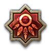 Featherfoot](catalogo/featherfoot.md) | 7 | Praticante de maldições e drenagem de vida, com ataques de osso e efeitos sangrentos. | 5 |
| [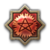 Warlock](catalogo/warlock.md) | 7 | Mago de trevas que cria e comanda espíritos ofensivos em torno de mortes e áreas de combate. | 5 |

## Archer · 13 classes

| Classe | Rank | O que fazia | Habilidades |
| --- | --- | --- | --- |
| [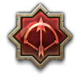 Archer](catalogo/archer.md) | 1 | Base de combate à distância, com múltiplos disparos, posicionamento e posturas de tiro. | 7 |
| [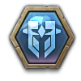 Quarrel Shooter](catalogo/quarrel-shooter.md) | 2 | Atirador de besta que combina defesa de posição, estrepes, pedras e ataques básicos em movimento. | 7 |
| [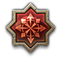 Ranger](catalogo/ranger.md) | 2 | Arqueiro ofensivo que alterna rajadas, tiros perfurantes e flechas de múltiplos acertos. | 7 |
| [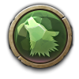 Hunter](catalogo/hunter.md) | 3 | Combate por meio do companheiro, comandando imobilizações, investidas, busca e perseguição. | 8 |
| [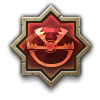 Sapper](catalogo/sapper.md) | 3 | Armador de explosivos e armadilhas para controlar passagens e causar dano em área. | 8 |
| [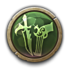 Scout](catalogo/scout.md) | 4 | Especialização histórica de Archer: furtividade, reconhecimento, sinalizadores e tiros que ricocheteiam. | 7 |
| [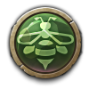 Wugushi](catalogo/wugushi.md) | 4 | Especialista em venenos duradouros, contágio e poças tóxicas, com antídotos e insetos venenosos. | 7 |
| [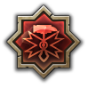 Fletcher](catalogo/fletcher.md) | 5 | Artesão de flechas especiais que explora sangramento, armadura, explosões e áreas de fogo. | 6 |
| [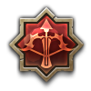 Rogue](catalogo/rogue.md) | 5 | Emboscador de ataques pelas costas, enganos, adaga e aproveitamento de armadilhas inimigas. | 8 |
| [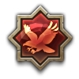 Falconer](catalogo/falconer.md) | 6 | Controla um falcão para reconhecimento de posição, ataques aéreos e apoio ao dano em área. | 7 |
| [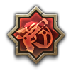 Schwarzer Reiter](catalogo/schwarzer-reiter.md) | 6 | Atirador montado que usa pistola e besta, mantendo pressão durante avanços e recuos. | 5 |
| [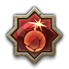 Cannoneer](catalogo/cannoneer.md) | 7 | Especialista em canhão, com explosões contra grupos, voadores e estruturas. | 4 |
| [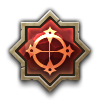 Musketeer](catalogo/musketeer.md) | 7 | Atirador de mosquete com disparos de precisão, penetração e recursos para combate próximo. | 6 |

## Cleric · 14 classes

| Classe | Rank | O que fazia | Habilidades |
| --- | --- | --- | --- |
| [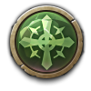 Cleric](catalogo/cleric.md) | 1 | Base de cura e proteção por círculos, com dano sagrado e enfraquecimento de inimigos. | 7 |
| [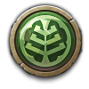 Krivis](catalogo/krivis.md) | 2 | Suporte ritual de relâmpagos, limite de benefícios e manutenção de efeitos do grupo. | 6 |
| [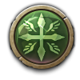 Priest](catalogo/priest.md) | 2 | Suporte religioso de reforços, ressurreição, cura coletiva e proteção contra derrota. | 9 |
| [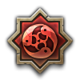 Bokor](catalogo/bokor.md) | 3 | Conjurador de maldições e zumbis, combinando dano remoto, comandos e sacrifício de invocações. | 9 |
| [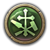 Dievdirbys](catalogo/dievdirbys.md) | 3 | Escultor de estátuas divinas que sustentam áreas de apoio, silêncio, transporte e proteção. | 7 |
| [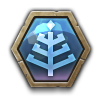 Paladin](catalogo/paladin.md) | 4 | Combatente sagrado de impacto, recuperação e proteção elemental, com barreiras e conversão. | 7 |
| [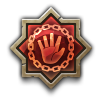 Sadhu](catalogo/sadhu.md) | 4 | Combatente espiritual que separa corpo e alma para atacar, controlar e transferir capacidades. | 6 |
| [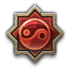 Monk](catalogo/monk.md) | 5 | Lutador de socos e golpes corporais, com técnicas de energia e defesa de caráter sobrenatural. | 8 |
| [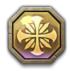 Pardoner](catalogo/pardoner.md) | 5 | Ofício religioso que vende benefícios e pergaminhos, prolonga efeitos negativos e recebe oferendas. | 7 |
| [ Chaplain · oculta](catalogo/chaplain.md) | 5 | Classe oculta derivada de Priest, voltada a reforços sagrados nos ataques e apoio por capela. | 4 |
| [ Druid](catalogo/druid.md) | 6 | Manipulador da natureza que usa vegetação, proteção e transformação em monstros. | 6 |
| [ Oracle](catalogo/oracle.md) | 6 | Suporte de previsão e alteração do destino: antecipa ataques, revela saque e transforma monstros. | 8 |
| [ Kabbalist](catalogo/kabbalist.md) | 7 | Suporte de símbolos e números, com reforço de HP, retaliação e cálculo sobre nomes inimigos. | 6 |
| [ Plague Doctor](catalogo/plague-doctor.md) | 7 | Especialista em estados negativos, cura reativa, prevenção, propagação de efeitos e incineração. | 6 |

**Próximo passo recomendado:** usar o catálogo para consolidar as classes da versão solo sem magia, incluindo o tratamento de híbridos; depois aprofundar as classes selecionadas.
