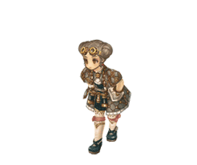
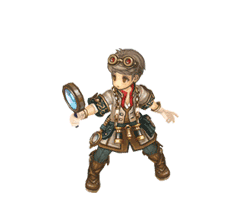

# Appraiser · Referência posterior e proposta solo

[Árvore solo de Archer](../catalogo-2016.md?view=solo&base=archer) · [Estudo das seis classes](../../projeto-solo/seis-classes-habilidades-e-circulos.md)

**Referência: página oficial atual, consultada em 15/11/2026. Fora do recorte de março–abril de 2016.** Esta ficha não reconstitui o kit original de lançamento da classe. [F106](../../fontes.md#f106)

Avaliação de itens, observação de inimigos e uso de lentes.

| Visual feminino | Visual masculino |
| :---: | :---: |
|  |  |

Imagens originais da IMC, preservadas sem alterações; sem confirmação de identidade exata com versões antigas. [Procedência](../../imagens.md).

## Habilidades da referência oficial atual

| Habilidade | Função resumida |
| --- | --- |
| Identify | Identifica itens em uma loja. |
| Expose Weakness | Expõe fraquezas e favorece críticos. |
| Devaluation | Reduz defesas do alvo. |
| High Scale Magnifying Glass | Melhora precisão e penetração de bloqueio. |
| Huge Magnifier | Causa dano e espalha Devaluation. |
| Triplet Lense | Lentes atacam inimigos automaticamente. |

Fonte: [F106](../../fontes.md#f106). São seis habilidades principais da seção SKILLS, com resumos editoriais. Atributos, Arts, números, equipamento e funcionamento em cliente não foram auditados. Nomes preservados como exibidos, inclusive grafias como Triplet Lense e Tre Granate quando presentes.

## Proposta de reaproveitamento e círculos

**Archer · R4 proposto · até C3 no limite de R7.** As marcações abaixo são avaliação editorial para o projeto solo, não regras do jogo original nem alterações já implementadas. O círculo indica uma sugestão de desbloqueio; habilidades de círculos anteriores continuam acessíveis ao investir mais na classe.

| Habilidade | Círculo proposto | Avaliação | Motivo ou pendência |
| --- | --- | --- | --- |
| Identify | C1 | Compatível na triagem | Preservar identificação; conferir a utilidade da loja na economia solo. |
| Expose Weakness | C1 | Compatível na triagem | A leitura de pontos vulneráveis combina com observação e treinamento. |
| Devaluation | C2 | Compatível na triagem | Compatível com o critério de combate físico estilizado aceito pelo proprietário. Explosivos, precisão, esquiva e efeitos de combate não são vetados por nome ou exagero visual; números continuam em aberto. |
| High Scale Magnifying Glass | C2 | Compatível na triagem | Pode manter a identidade de análise e mira. |
| Huge Magnifier | C3 | Compatível na triagem | Compatível com o critério de combate físico estilizado aceito pelo proprietário. Explosivos, precisão, esquiva e efeitos de combate não são vetados por nome ou exagero visual; números continuam em aberto. |
| Triplet Lense | C3 | Pendente · suspensa por enquanto | Animação pendente. O proprietário sugeriu avaliar conversão em passiva óptica; nenhum efeito ou número foi definido. |

Compatível na triagem significa identidade aceita para o estudo, sem certificação de funcionamento no cliente. As quatro habilidades de facas marcadas dependem de animação. Suspensa significa não tratar a habilidade como jogável enquanto a pendência existir. Não copiamos fórmulas atuais para o balanceamento solo.

A página atual exige desbloqueio e menciona o segundo avanço. Isso não é um rank antigo nem um requisito solo já aprovado. **Triplet Lense permanece suspensa:** seu lugar experimental em C3 não a inclui no kit jogável.

**Próximo passo recomendado:** revisar os efeitos marcados e comparar os pares de rank no [estudo conjunto](../../projeto-solo/seis-classes-habilidades-e-circulos.md) antes de fechar progressão e números.

## Ideia de passiva ainda pendente

O proprietário sugeriu estudar Triplet Lense como passiva ligada à lente já usada por Appraiser. A referência atual é ofensiva e ativa: converter em passiva exige definir outro funcionamento. **Nenhum bônus, efeito, fórmula ou desbloqueio de passiva foi aprovado ou implementado.**
