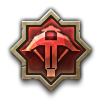
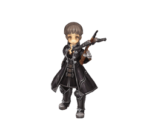
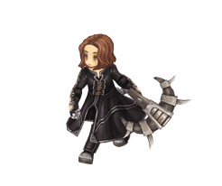

# Arbalester · Referência posterior e proposta solo

[Árvore solo de Archer](../catalogo-2016.md?view=solo&base=archer) · [Estudo das seis classes](../../projeto-solo/seis-classes-habilidades-e-circulos.md)

**Referência: página oficial atual, consultada em 15/11/2026. Fora do recorte de março–abril de 2016.** Esta ficha não reconstitui o kit original de lançamento da classe. [F103](../../fontes.md#f103)

Besta, marcação de alvos, mobilidade e projéteis guiados.

| Visual feminino | Visual masculino |
| :---: | :---: |
|  |  |

Imagens originais da IMC, preservadas sem alterações; sem confirmação de identidade exata com versões antigas. [Procedência](../../imagens.md).

## Habilidades da referência oficial atual

| Habilidade | Função resumida |
| --- | --- |
| Dark Judgement | Explosão marca inimigos. |
| Dead Zone | Flechas atingem a área próxima. |
| Escape | Recua, dispara e deixa uma marca. |
| Fanwise Shots | Dispara vários projéteis em leque. |
| Guided Shot | Dispara projéteis e marca alvos. |
| Shining Burst | Dispara girando e permite movimento. |

Fonte: [F103](../../fontes.md#f103). São seis habilidades principais da seção SKILLS, com resumos editoriais. Atributos, Arts, números, equipamento e funcionamento em cliente não foram auditados. Nomes preservados como exibidos, inclusive grafias como Triplet Lense e Tre Granate quando presentes.

## Proposta de reaproveitamento e círculos

**Archer · R5 proposto · até C3 no limite de R7.** As marcações abaixo são avaliação editorial para o projeto solo, não regras do jogo original nem alterações já implementadas. O círculo indica uma sugestão de desbloqueio; habilidades de círculos anteriores continuam acessíveis ao investir mais na classe.

| Habilidade | Círculo proposto | Avaliação | Motivo ou pendência |
| --- | --- | --- | --- |
| Dark Judgement | C3 | Revisar | Inspecionar a explosão e seu recurso material antes de adotar uma explicação química. |
| Dead Zone | C2 | Candidata a reaproveitamento | Pode funcionar como uma sequência de disparos. |
| Escape | C1 | Candidata a reaproveitamento | Mobilidade e posicionamento combinam com a besta. |
| Fanwise Shots | C1 | Candidata a reaproveitamento | Reaproveitar a técnica de disparo. |
| Guided Shot | C2 | Revisar | A fonte cita tecnologia de guiagem; seu mecanismo precisa ser inspecionado. |
| Shining Burst | C3 | Candidata a reaproveitamento | Conferir animação e equipamento; não exige criar um novo sistema. |

Candidata a reaproveitamento significa compatibilidade temática inicial, sujeita à conferência de animação e cliente. Revisar exige decidir efeitos ou regras; suspender significa não tratar a habilidade como jogável enquanto a pendência existir. Não copiamos fórmulas atuais para o balanceamento solo.

**Próximo passo recomendado:** revisar os efeitos marcados e comparar os pares de rank no [estudo conjunto](../../projeto-solo/seis-classes-habilidades-e-circulos.md) antes de fechar progressão e números.
