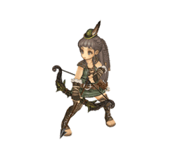
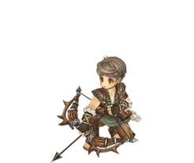

# Archer · Panorama de 2016

[Catálogo de todas as classes](../catalogo-2016.md) · [Diretrizes solo](../../projeto-solo/diretrizes.md)

**Árvore histórica: Archer · Primeiro rank: 1.**

Base de combate à distância, com múltiplos disparos, posicionamento e posturas de tiro.

| Visual feminino | Visual masculino |
| :---: | :---: |
|  |  |

*Imagens originais da IMC, preservadas sem alterações. São arquivos do site oficial atual; sua identidade visual exata em 2016 continua em conferência. [Procedência](../../imagens.md).*

## Habilidades e estilo de jogo

| Círculo | Habilidade | Função resumida |
| --- | --- | --- |
| C1 | Swift Step | Melhora movimento e esquiva durante deslocamento. |
| C1 | Multi Shot | Dispara várias flechas na área escolhida. |
| C1 | Full Draw | Tiro carregado que prende inimigos ao terreno. |
| C1 | Oblique Shot | Flecha que ricocheteia para um inimigo próximo. |
| C2 | Kneeling Shot | Postura ajoelhada que melhora ataque, velocidade e alcance. |
| C2 | Heavy Shot | Disparo forte que empurra o alvo. |
| C3 | Twin Arrows | Dispara duas flechas contra o alvo. |

Fonte das habilidades: [F66](../../fontes.md#f66), captura de **2016-04-05**. Os resumos são editoriais e não substituem testes no cliente. O banco contém descrições, não uma garantia de todos os efeitos implementados naquele patch.

## Recorte e versão solo

Esta ficha de panorama inclui os círculos compatíveis com o limite de **Rank 7**, com classes ocultas em C1. Não introduzimos habilidades de círculos de expansão posterior. Nomes históricos foram preservados, inclusive quando a grafia difere de guias ou versões mais novas.

A adaptação solo **removerá classes mágicas**. Esta página preserva o original para consulta; a seleção nominal e o tratamento de híbridos estão nas [diretrizes do projeto](../../projeto-solo/diretrizes.md).

[Abrir a ficha já pesquisada de Archer](../archer.md).
