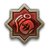
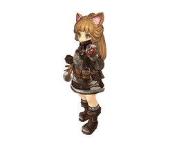
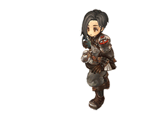

# Ardito · Referência posterior e proposta solo

[Árvore solo de Scout](../catalogo-2016.md?view=solo&base=scout) · [Estudo das seis classes](../../projeto-solo/seis-classes-habilidades-e-circulos.md)

**Referência: página oficial atual, consultada em 15/11/2026. Fora do recorte de março–abril de 2016.** Esta ficha não reconstitui o kit original de lançamento da classe. [F108](../../fontes.md#f108)

Adagas, granadas, preparados e combate de assalto.

| Visual feminino | Visual masculino |
| :---: | :---: |
|  |  |

Imagens originais da IMC, preservadas sem alterações; sem confirmação de identidade exata com versões antigas. [Procedência](../../imagens.md).

## Habilidades da referência oficial atual

| Habilidade | Função resumida |
| --- | --- |
| Granata | Lança uma granada em área. |
| Invasione | Estoca e interage com Gunpowder. |
| Recupero | Seringa recupera HP e stamina próprios. |
| Ritirarsi | Recua após soltar uma granada; evita dano. |
| Taglio | Avança cortando e ganha mobilidade. |
| Tre Granate | Lança três coquetéis incendiários. |

Fonte: [F108](../../fontes.md#f108). São seis habilidades principais da seção SKILLS, com resumos editoriais. Atributos, Arts, números, equipamento e funcionamento em cliente não foram auditados. Nomes preservados como exibidos, inclusive grafias como Triplet Lense e Tre Granate quando presentes.

## Proposta de reaproveitamento e círculos

**Scout · R4 proposto · até C3 no limite de R7.** As marcações abaixo são avaliação editorial para o projeto solo, não regras do jogo original nem alterações já implementadas. O círculo indica uma sugestão de desbloqueio; habilidades de círculos anteriores continuam acessíveis ao investir mais na classe.

| Habilidade | Círculo proposto | Avaliação | Motivo ou pendência |
| --- | --- | --- | --- |
| Granata | C1 | Candidata a reaproveitamento | Preservar explosivos como itens, com consumo e disponibilidade a conferir. |
| Invasione | C1 | Revisar | Revisar a interação que amplia o ataque; não importar automaticamente os bônus atuais. |
| Recupero | C2 | Candidata a reaproveitamento | É autocura existente por recurso material; não transforma Ardito em curador de grupo. |
| Ritirarsi | C2 | Revisar | Distinguir uma janela de esquiva de proteção sobrenatural; inspecionar a animação. |
| Taglio | C3 | Candidata a reaproveitamento | Pode manter a identidade de movimento e ataque. |
| Tre Granate | C3 | Candidata a reaproveitamento | Fogo por combustível não implica magia; confirmar recursos e efeitos originais. |

Candidata a reaproveitamento significa compatibilidade temática inicial, sujeita à conferência de animação e cliente. Revisar exige decidir efeitos ou regras; suspender significa não tratar a habilidade como jogável enquanto a pendência existir. Não copiamos fórmulas atuais para o balanceamento solo.

Recupero é **autocura**, não cura de grupo. A referência lista uma interação de Arts que remove sua recuperação de HP; Arts não foram importadas para a proposta.

**Próximo passo recomendado:** revisar os efeitos marcados e comparar os pares de rank no [estudo conjunto](../../projeto-solo/seis-classes-habilidades-e-circulos.md) antes de fechar progressão e números.
