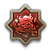
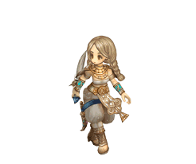
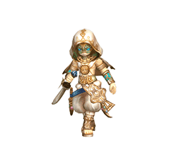

# Assassin · Referência posterior ao lançamento

[Árvore solo de Scout](../catalogo-2016.md?view=solo&base=scout) · [Estudo de ranks](../../projeto-solo/ranks-e-especializacoes.md)

**Origem: Scout, Re:Build internacional de 15/01/2019. Não pertence ao catálogo de 2016.** [F100](../../fontes.md#f100)

Combatente de adagas, emboscadas, fumaça e preparados Hasisas.

| Visual feminino | Visual masculino |
| :---: | :---: |
|  |  |

Imagens originais da IMC, preservadas sem alterações. Arquivos oficiais atuais, sem confirmação de identidade exata em 2019. [Procedência](../../imagens.md).

## Habilidades de referência

**Fonte: página oficial atual, consultada em 15/11/2026.** Estes resumos não reconstituem o balanceamento de 2019. Não atribuímos círculos antigos a habilidades posteriores.

| Habilidade | Função resumida |
| --- | --- |
| Annihilation | Ataques rápidos próximos, com ocultação e proteção durante a execução. |
| Behead | Golpe de adaga que provoca sangramento. |
| Hallucination Smoke | Fumaça que prejudica a visão, a precisão e a esquiva. |
| Hasisas | Preparado que melhora temporariamente capacidades físicas e ataques críticos. |
| Instant Acceleration | Avanço rápido para atingir um inimigo distante. |
| Piercing Heart | Estocada que atravessa parte da defesa e impede recuperação de HP. |

Fonte: [F101](../../fontes.md#f101). Resumos editoriais; sem valores numéricos, atributos ou confirmação em cliente.

## Encaixe na versão solo

**Scout · posição proposta.** O rank solo é uma hipótese de organização, não um rank histórico. As duas classes foram adicionadas na atualização que removeu ranks e círculos [F100](../../fontes.md#f100).

O kit original tem recursos físicos e por itens que merecem reaproveitamento. Efeitos de ocultação, invulnerabilidade e demais exceções ainda exigem revisão, seguindo o critério de remover magia. A seleção visual não aprova todas as habilidades.

**Próximo passo recomendado:** conferir o [mapa de ranks e suas hipóteses](../../projeto-solo/ranks-e-especializacoes.md), antes de definir progressão e números.
