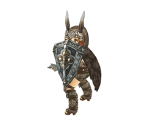
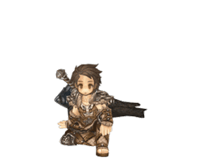

# Barbarian · Panorama de 2016

[Catálogo de todas as classes](../catalogo-2016.md) · [Diretrizes solo](../../projeto-solo/diretrizes.md)

**Árvore histórica: Swordsman · Primeiro rank: 3.**

Combatente agressivo que acumula força, atordoa e avança com ataques de grande impacto.

| Visual feminino | Visual masculino |
| :---: | :---: |
|  |  |

*Imagens originais da IMC, preservadas sem alterações. São arquivos do site oficial atual; sua identidade visual exata em 2016 continua em conferência. [Procedência](../../imagens.md).*

## Habilidades e estilo de jogo

| Círculo | Habilidade | Função resumida |
| --- | --- | --- |
| C1 | Embowel | Perfura e chuta o inimigo para longe. |
| C1 | Stomping Kick | Pisoteio aéreo influenciado pelo salto e pelas botas. |
| C1 | Cleave | Golpe giratório favorecido contra inimigos atordoados. |
| C1 | Helm Chopper | Pancada na cabeça que atordoa. |
| C2 | Warcry | Reduz a defesa próxima e fortalece seu ataque. |
| C2 | Frenzy | Ataques repetidos ao mesmo alvo acumulam força. |
| C2 | Seism | Abalo com chance de atordoamento. |
| C3 | Giant Swing | Gira um inimigo e o arremessa. |
| C3 | Pouncing | Avança atacando com cortes contínuos. |

Fonte das habilidades: [F41](../../fontes.md#f41), captura de **2016-04-01**. Os resumos são editoriais e não substituem testes no cliente. O banco contém descrições, não uma garantia de todos os efeitos implementados naquele patch.

## Recorte e versão solo

Esta ficha de panorama inclui os círculos compatíveis com o limite de **Rank 7**, com classes ocultas em C1. Não introduzimos habilidades de círculos de expansão posterior. Nomes históricos foram preservados, inclusive quando a grafia difere de guias ou versões mais novas.

A adaptação solo **removerá classes mágicas**. Esta página preserva o original para consulta; a seleção nominal e o tratamento de híbridos estão nas [diretrizes do projeto](../../projeto-solo/diretrizes.md).
