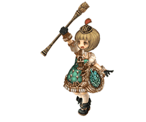
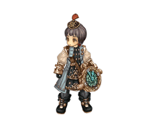

# Chronomancer · Panorama de 2016

[Catálogo de todas as classes](../catalogo-2016.md) · [Diretrizes solo](../../projeto-solo/diretrizes.md)

**Árvore histórica: Wizard · Primeiro rank: 5.**

Suporte temporal que altera velocidade, recargas e estados anteriores do campo.

| Visual feminino | Visual masculino |
| :---: | :---: |
|  |  |

*Imagens originais da IMC, preservadas sem alterações. São arquivos do site oficial atual; sua identidade visual exata em 2016 continua em conferência. [Procedência](../../imagens.md).*

## Habilidades e estilo de jogo

| Círculo | Habilidade | Função resumida |
| --- | --- | --- |
| C1 | Quicken | Acelera os ataques do grupo. |
| C1 | Reincarnate | Faz um monstro derrotado reaparecer no local. |
| C1 | Stop | Congela o tempo dos monstros, que não recebem dano. |
| C1 | Slow | Desacelera o movimento dos inimigos. |
| C2 | Haste | Acelera o movimento do grupo. |
| C3 | Backmasking | Restaura temporariamente um estado anterior da área. |
| C3 | Pass | Reduz recargas de habilidades do grupo. |

Fonte das habilidades: [F59](../../fontes.md#f59), captura de **2016-04-02**. Os resumos são editoriais e não substituem testes no cliente. O banco contém descrições, não uma garantia de todos os efeitos implementados naquele patch.

## Recorte e versão solo

Esta ficha de panorama inclui os círculos compatíveis com o limite de **Rank 7**, com classes ocultas em C1. Não introduzimos habilidades de círculos de expansão posterior. Nomes históricos foram preservados, inclusive quando a grafia difere de guias ou versões mais novas.

A adaptação solo **removerá classes mágicas**. Esta página preserva o original para consulta; a seleção nominal e o tratamento de híbridos estão nas [diretrizes do projeto](../../projeto-solo/diretrizes.md).
