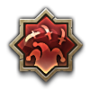
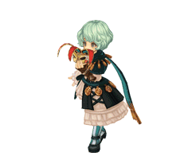
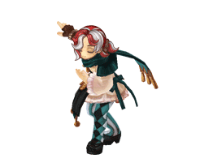

# Clown · Referência posterior e proposta solo

[Árvore solo de Scout](../catalogo-2016.md?view=solo&base=scout) · [Estudo das seis classes](../../projeto-solo/seis-classes-habilidades-e-circulos.md)

**Referência: página oficial atual, consultada em 15/11/2026. Fora do recorte de março–abril de 2016.** Esta ficha não reconstitui o kit original de lançamento da classe. [F110](../../fontes.md#f110)

Facas arremessadas, movimentação e truques de combate.

| Visual feminino | Visual masculino |
| :---: | :---: |
|  |  |

Imagens originais da IMC, preservadas sem alterações; sem confirmação de identidade exata com versões antigas. [Procedência](../../imagens.md).

## Habilidades da referência oficial atual

| Habilidade | Função resumida |
| --- | --- |
| Climax | Arremessa facas e ativa facas no chão. |
| Clown Walk | Passos confundem e limitam movimento inimigo. |
| Fatal Roulette | Gira arremessando facas. |
| Replica | Lança facas que caem e reagem a habilidades. |
| Spinning Knife | Arremessa uma faca com trajetória de retorno. |
| Trick or Treat | Espalha facas e aplica bônus ou penalidades. |

Fonte: [F110](../../fontes.md#f110). São seis habilidades principais da seção SKILLS, com resumos editoriais. Atributos, Arts, números, equipamento e funcionamento em cliente não foram auditados. Nomes preservados como exibidos, inclusive grafias como Triplet Lense e Tre Granate quando presentes.

## Proposta de reaproveitamento e círculos

**Scout · R2 proposto · até C3 no limite de R7.** As marcações abaixo são avaliação editorial para o projeto solo, não regras do jogo original nem alterações já implementadas. O círculo indica uma sugestão de desbloqueio; habilidades de círculos anteriores continuam acessíveis ao investir mais na classe.

| Habilidade | Círculo proposto | Avaliação | Motivo ou pendência |
| --- | --- | --- | --- |
| Climax | C3 | Conferir animação | Conferir arremessos, retorno e ativação das facas antes de decidir se o truque visual cabe na proposta. A inspeção fica para depois, conforme o proprietário. |
| Clown Walk | C1 | Compatível na triagem | Compatível com o critério de combate físico estilizado aceito pelo proprietário. Explosivos, precisão, esquiva e efeitos de combate não são vetados por nome ou exagero visual; números continuam em aberto. |
| Fatal Roulette | C2 | Conferir animação | Conferir arremessos, retorno e ativação das facas antes de decidir se o truque visual cabe na proposta. A inspeção fica para depois, conforme o proprietário. |
| Replica | C3 | Conferir animação | Conferir arremessos, retorno e ativação das facas antes de decidir se o truque visual cabe na proposta. A inspeção fica para depois, conforme o proprietário. |
| Spinning Knife | C1 | Conferir animação | Conferir arremessos, retorno e ativação das facas antes de decidir se o truque visual cabe na proposta. A inspeção fica para depois, conforme o proprietário. |
| Trick or Treat | C2 | Compatível na triagem | Compatível com o critério de combate físico estilizado aceito pelo proprietário. Explosivos, precisão, esquiva e efeitos de combate não são vetados por nome ou exagero visual; números continuam em aberto. |

Compatível na triagem significa identidade aceita para o estudo, sem certificação de funcionamento no cliente. As quatro habilidades de facas marcadas dependem de animação. Suspensa significa não tratar a habilidade como jogável enquanto a pendência existir. Não copiamos fórmulas atuais para o balanceamento solo.

**Próximo passo recomendado:** revisar os efeitos marcados e comparar os pares de rank no [estudo conjunto](../../projeto-solo/seis-classes-habilidades-e-circulos.md) antes de fechar progressão e números.
