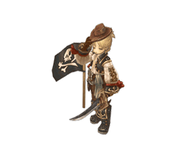

# Corsair · Panorama de 2016

[Catálogo de todas as classes](../catalogo-2016.md) · [Diretrizes solo](../../projeto-solo/diretrizes.md)

**Árvore histórica: Swordsman · Primeiro rank: 5.**

Pirata de gancho, pilhagem e duas armas, com sequências de adaga e acesso posterior à pistola.

| Visual feminino | Visual masculino |
| :---: | :---: |
|  |  |

*Imagens originais da IMC, preservadas sem alterações. São arquivos do site oficial atual; sua identidade visual exata em 2016 continua em conferência. [Procedência](../../imagens.md).*

## Habilidades e estilo de jogo

| Círculo | Habilidade | Função resumida |
| --- | --- | --- |
| C1 | Jolly Roger | Bandeira pirata com apoio ao grupo e chance de pilhagem. |
| C1 | Iron Hook | Prende inimigos com um gancho. |
| C1 | Keel Hauling | Arrasta e machuca alvos presos pelo gancho. |
| C1 | Unlock Chest | Abre baús de baixo nível com chave. |
| C1 | Dust Devil | Giro com duas armas que prende brevemente o alvo. |
| C2 | Double Weapon Assault | Combina ataques básicos com ataques de adaga. |
| C2 | Hexen Dropper | Sequência perfurante usando uma arma em cada mão. |
| C3 | Pistol Shot | Dispara a pistola repetidamente contra inimigos à frente. |

Fonte das habilidades: [F45](../../fontes.md#f45), captura de **2016-04-05**. Os resumos são editoriais e não substituem testes no cliente. O banco contém descrições, não uma garantia de todos os efeitos implementados naquele patch.

## Recorte e versão solo

Esta ficha de panorama inclui os círculos compatíveis com o limite de **Rank 7**, com classes ocultas em C1. Não introduzimos habilidades de círculos de expansão posterior. Nomes históricos foram preservados, inclusive quando a grafia difere de guias ou versões mais novas.

A adaptação solo **removerá classes mágicas**. Esta página preserva o original para consulta; a seleção nominal e o tratamento de híbridos estão nas [diretrizes do projeto](../../projeto-solo/diretrizes.md).
