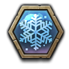

# Cryomancer · Panorama de 2016

[Catálogo de todas as classes](../catalogo-2016.md) · [Diretrizes solo](../../projeto-solo/diretrizes.md)

**Árvore histórica: Wizard · Primeiro rank: 2.**

Mago de gelo focado em congelamento, paredes e agrupamento de inimigos.

| Visual feminino | Visual masculino |
| :---: | :---: |
|  |  |

*Imagens originais da IMC, preservadas sem alterações. São arquivos do site oficial atual; sua identidade visual exata em 2016 continua em conferência. [Procedência](../../imagens.md).*

## Habilidades e estilo de jogo

| Círculo | Habilidade | Função resumida |
| --- | --- | --- |
| C1 | Ice Bolt | Projétil gelado com chance de congelar. |
| C1 | Ice Pike | Espinhos de gelo em linha, com chance de congelamento. |
| C1 | Ice Wall | Ergue uma parede de gelo para conter inimigos. |
| C1 | Ice Blast | Explode gelo contra um alvo congelado. |
| C2 | Subzero Shield | Defesa de gelo que pode congelar agressores. |
| C2 | Gust | Rajada que empurra e pode romper congelamento. |
| C3 | Snow Rolling | Avança numa bola de neve esmagando inimigos. |
| C3 | Frost Pillar | Árvore de gelo que atrai e pode congelar. |

Fonte das habilidades: [F53](../../fontes.md#f53), captura de **2016-04-02**. Os resumos são editoriais e não substituem testes no cliente. O banco contém descrições, não uma garantia de todos os efeitos implementados naquele patch.

## Recorte e versão solo

Esta ficha de panorama inclui os círculos compatíveis com o limite de **Rank 7**, com classes ocultas em C1. Não introduzimos habilidades de círculos de expansão posterior. Nomes históricos foram preservados, inclusive quando a grafia difere de guias ou versões mais novas.

A adaptação solo **removerá classes mágicas**. Esta página preserva o original para consulta; a seleção nominal e o tratamento de híbridos estão nas [diretrizes do projeto](../../projeto-solo/diretrizes.md).
