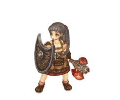
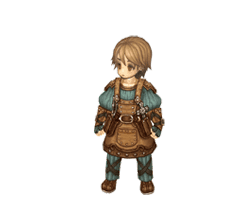

# Dievdirbys · Panorama de 2016

[Catálogo de todas as classes](../catalogo-2016.md) · [Diretrizes solo](../../projeto-solo/diretrizes.md)

**Árvore histórica: Cleric · Primeiro rank: 3.**

Escultor de estátuas divinas que sustentam áreas de apoio, silêncio, transporte e proteção.

| Visual feminino | Visual masculino |
| :---: | :---: |
|  |  |

*Imagens originais da IMC, preservadas sem alterações. São arquivos do site oficial atual; sua identidade visual exata em 2016 continua em conferência. [Procedência](../../imagens.md).*

## Habilidades e estilo de jogo

| Círculo | Habilidade | Função resumida |
| --- | --- | --- |
| C1 | Carve Vakarine | Esculpe uma estátua que permite transporte entre áreas. |
| C1 | Statue of Goddess Zemyna | Estátua que reduz gasto de SP e ajuda recuperação. |
| C1 | Statue of Goddess Laima | Estátua que reduz recargas do grupo próximo. |
| C1 | Carve Attack | Golpes de entalhe favorecidos contra monstros Planta. |
| C2 | Carve Owl | Esculpe uma coruja ofensiva para defender a posição. |
| C2 | Carve World Tree | Árvore esculpida que silencia inimigos próximos. |
| C3 | Statue of Goddess Ausrine | Estátua cujo ritual concede proteção temporária contra dano. |

Fonte das habilidades: [F83](../../fontes.md#f83), captura de **2016-03-31**. Os resumos são editoriais e não substituem testes no cliente. O banco contém descrições, não uma garantia de todos os efeitos implementados naquele patch.

## Recorte e versão solo

Esta ficha de panorama inclui os círculos compatíveis com o limite de **Rank 7**, com classes ocultas em C1. Não introduzimos habilidades de círculos de expansão posterior. Nomes históricos foram preservados, inclusive quando a grafia difere de guias ou versões mais novas.

A adaptação solo **removerá classes mágicas**. Esta página preserva o original para consulta; a seleção nominal e o tratamento de híbridos estão nas [diretrizes do projeto](../../projeto-solo/diretrizes.md).
