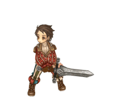

# Doppelsoeldner · Panorama de 2016

[Catálogo de todas as classes](../catalogo-2016.md) · [Diretrizes solo](../../projeto-solo/diretrizes.md)

**Árvore histórica: Swordsman · Primeiro rank: 6.**

Atacante de espada que aceita mais risco para aumentar pressão ofensiva e executar ataques giratórios.

| Visual feminino | Visual masculino |
| :---: | :---: |
|  |  |

*Imagens originais da IMC, preservadas sem alterações. São arquivos do site oficial atual; sua identidade visual exata em 2016 continua em conferência. [Procedência](../../imagens.md).*

## Habilidades e estilo de jogo

| Círculo | Habilidade | Função resumida |
| --- | --- | --- |
| C1 | Punish | Perfura um inimigo caído. |
| C1 | Deeds of Valor | Receber dano aumenta ataque e velocidade, sacrificando defesa. |
| C1 | Mordschlag | Pancada usando o cabo da espada. |
| C1 | Double Pay Earn | Busca EXP e saque dobrados sob risco aumentado. |
| C1 | Cyclone | Ataque giratório contínuo com a arma. |
| C2 | Zornhau | Corte forte que aplica choque. |
| C2 | Zucken | Cortes laterais favorecidos contra alvos sob choque. |
| C2 | Redel | Sequência de cortes contra o alvo à frente. |

Fonte das habilidades: [F47](../../fontes.md#f47), captura de **2016-03-30**. Os resumos são editoriais e não substituem testes no cliente. O banco contém descrições, não uma garantia de todos os efeitos implementados naquele patch.

## Recorte e versão solo

Esta ficha de panorama inclui os círculos compatíveis com o limite de **Rank 7**, com classes ocultas em C1. Não introduzimos habilidades de círculos de expansão posterior. Nomes históricos foram preservados, inclusive quando a grafia difere de guias ou versões mais novas.

A adaptação solo **removerá classes mágicas**. Esta página preserva o original para consulta; a seleção nominal e o tratamento de híbridos estão nas [diretrizes do projeto](../../projeto-solo/diretrizes.md).

## Triagem de disponibilidade solo

**Sem impedimento temático evidente.** A identidade é compatível com o critério de combate físico estilizado. Essa triagem não certifica funcionamento em cliente nem altera as habilidades originais acima. [Situação do elenco e pendências](../../projeto-solo/disponibilidade-das-classes.md).
