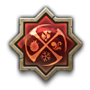
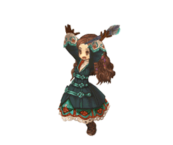

# Elementalist · Panorama de 2016

[Catálogo de todas as classes](../catalogo-2016.md) · [Diretrizes solo](../../projeto-solo/diretrizes.md)

**Árvore histórica: Wizard · Primeiro rank: 4.**

Conjurador ofensivo que combina relâmpagos, gelo, fogo e grandes áreas de dano.

| Visual feminino | Visual masculino |
| :---: | :---: |
|  |  |

*Imagens originais da IMC, preservadas sem alterações. São arquivos do site oficial atual; sua identidade visual exata em 2016 continua em conferência. [Procedência](../../imagens.md).*

## Habilidades e estilo de jogo

| Círculo | Habilidade | Função resumida |
| --- | --- | --- |
| C1 | Electrocute | Descarga elétrica contra inimigos à frente. |
| C1 | Stone Curse | Petrifica temporariamente um alvo. |
| C1 | Hail | Chuva de gelo que causa dano contínuo. |
| C1 | Prominence | Chama móvel que percorre a área aleatoriamente. |
| C2 | Meteor | Derruba um meteoro na área escolhida. |
| C2 | Freezing Sphere | Arremessa uma esfera de gelo. |
| C3 | Rain | Cria chuva com efeitos na área escolhida. |
| C3 | Frost Cloud | Área gelada de dano contínuo. |

Fonte das habilidades: [F57](../../fontes.md#f57), captura de **2016-04-02**. Os resumos são editoriais e não substituem testes no cliente. O banco contém descrições, não uma garantia de todos os efeitos implementados naquele patch.

## Recorte e versão solo

Esta ficha de panorama inclui os círculos compatíveis com o limite de **Rank 7**, com classes ocultas em C1. Não introduzimos habilidades de círculos de expansão posterior. Nomes históricos foram preservados, inclusive quando a grafia difere de guias ou versões mais novas.

A adaptação solo **removerá classes mágicas**. Esta página preserva o original para consulta; a seleção nominal e o tratamento de híbridos estão nas [diretrizes do projeto](../../projeto-solo/diretrizes.md).
