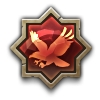
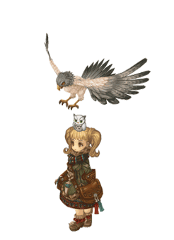
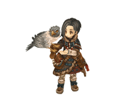

# Falconer · Panorama de 2016

[Catálogo de todas as classes](../catalogo-2016.md) · [Diretrizes solo](../../projeto-solo/diretrizes.md)

**Árvore histórica: Archer · Primeiro rank: 6.**

Controla um falcão para reconhecimento de posição, ataques aéreos e apoio ao dano em área.

| Visual feminino | Visual masculino |
| :---: | :---: |
|  |  |

*Imagens originais da IMC, preservadas sem alterações. São arquivos do site oficial atual; sua identidade visual exata em 2016 continua em conferência. [Procedência](../../imagens.md).*

## Habilidades e estilo de jogo

| Círculo | Habilidade | Função resumida |
| --- | --- | --- |
| C1 | Call | Chama o falcão de volta. |
| C1 | Roost | Instala um poleiro para o falcão aguardar ordens. |
| C1 | Circling | Falcão reduz a defesa de área dos inimigos próximos. |
| C1 | Hovering | Falcão ataca quem passa abaixo da área marcada. |
| C1 | Pheasant | Ordena ataque do falcão numa área usando um boneco. |
| C1 | Hanging Shot | Permite atacar pendurado no falcão, evitando golpes próximos. |
| C2 | Sonic Strike | Ordena vários mergulhos ofensivos do falcão. |

Fonte das habilidades: [F75](../../fontes.md#f75), captura de **2016-04-05**. Os resumos são editoriais e não substituem testes no cliente. O banco contém descrições, não uma garantia de todos os efeitos implementados naquele patch.

## Recorte e versão solo

Esta ficha de panorama inclui os círculos compatíveis com o limite de **Rank 7**, com classes ocultas em C1. Não introduzimos habilidades de círculos de expansão posterior. Nomes históricos foram preservados, inclusive quando a grafia difere de guias ou versões mais novas.

A adaptação solo **removerá classes mágicas**. Esta página preserva o original para consulta; a seleção nominal e o tratamento de híbridos estão nas [diretrizes do projeto](../../projeto-solo/diretrizes.md).

## Triagem de disponibilidade solo

**Sem impedimento temático evidente.** A identidade é compatível com o critério de combate físico estilizado. Essa triagem não certifica funcionamento em cliente nem altera as habilidades originais acima. [Situação do elenco e pendências](../../projeto-solo/disponibilidade-das-classes.md).
