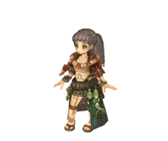
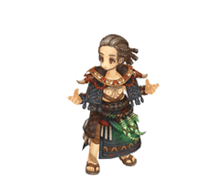

# Featherfoot · Panorama de 2016

[Catálogo de todas as classes](../catalogo-2016.md) · [Diretrizes solo](../../projeto-solo/diretrizes.md)

**Árvore histórica: Wizard · Primeiro rank: 7.**

Praticante de maldições e drenagem de vida, com ataques de osso e efeitos sangrentos.

| Visual feminino | Visual masculino |
| :---: | :---: |
|  |  |

*Imagens originais da IMC, preservadas sem alterações. São arquivos do site oficial atual; sua identidade visual exata em 2016 continua em conferência. [Procedência](../../imagens.md).*

## Habilidades e estilo de jogo

| Círculo | Habilidade | Função resumida |
| --- | --- | --- |
| C1 | Blood Bath | Ataque que extrai sangue curativo de certos monstros. |
| C1 | Blood Sucking | Drena vida de feras, demônios e insetos. |
| C1 | Bone Pointing | Invoca um osso que ataca e amaldiçoa. |
| C1 | Ngadhundi | Facada de osso que aplica deterioração ao inimigo. |
| C1 | Kurdaitcha | Deixa pegadas sangrentas que amaldiçoam ao contato. |

Fonte das habilidades: [F64](../../fontes.md#f64), captura de **2016-03-31**. Os resumos são editoriais e não substituem testes no cliente. O banco contém descrições, não uma garantia de todos os efeitos implementados naquele patch.

## Recorte e versão solo

Esta ficha de panorama inclui os círculos compatíveis com o limite de **Rank 7**, com classes ocultas em C1. Não introduzimos habilidades de círculos de expansão posterior. Nomes históricos foram preservados, inclusive quando a grafia difere de guias ou versões mais novas.

A adaptação solo **removerá classes mágicas**. Esta página preserva o original para consulta; a seleção nominal e o tratamento de híbridos estão nas [diretrizes do projeto](../../projeto-solo/diretrizes.md).
