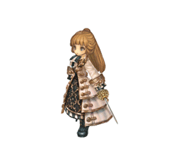
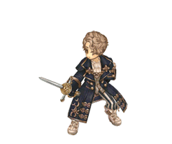

# Fencer · Panorama de 2016

[Catálogo de todas as classes](../catalogo-2016.md) · [Diretrizes solo](../../projeto-solo/diretrizes.md)

**Árvore histórica: Swordsman · Primeiro rank: 6.**

Duelista de rapieira, com estocadas rápidas, esquivas, aparos e exposição do adversário.

| Visual feminino | Visual masculino |
| :---: | :---: |
|  |  |

*Imagens originais da IMC, preservadas sem alterações. São arquivos do site oficial atual; sua identidade visual exata em 2016 continua em conferência. [Procedência](../../imagens.md).*

## Habilidades e estilo de jogo

| Círculo | Habilidade | Função resumida |
| --- | --- | --- |
| C1 | Lunge | Estocada que aumenta esquiva e expõe o alvo a cortes. |
| C1 | Sept Etoiles | Série rápida de estocadas. |
| C1 | Attaque Coquille | Expõe o alvo a ataques perfurantes que ignoram defesa. |
| C1 | Esquive Toucher | Movimento evasivo acompanhado de estocadas. |
| C1 | Flanconnade | Corte ascendente que também protege contra um ataque. |
| C2 | Attaque Composee | Estocada frontal de rapieira. |
| C2 | Preparation | Prepara defesa e fortalece a próxima perfuração. |

Fonte das habilidades: [F48](../../fontes.md#f48), captura de **2016-03-30**. Os resumos são editoriais e não substituem testes no cliente. O banco contém descrições, não uma garantia de todos os efeitos implementados naquele patch.

## Recorte e versão solo

Esta ficha de panorama inclui os círculos compatíveis com o limite de **Rank 7**, com classes ocultas em C1. Não introduzimos habilidades de círculos de expansão posterior. Nomes históricos foram preservados, inclusive quando a grafia difere de guias ou versões mais novas.

A adaptação solo **removerá classes mágicas**. Esta página preserva o original para consulta; a seleção nominal e o tratamento de híbridos estão nas [diretrizes do projeto](../../projeto-solo/diretrizes.md).
