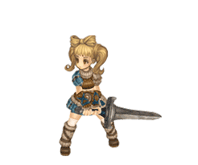
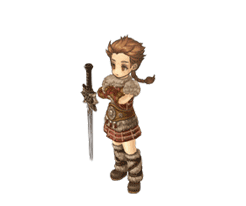

# Highlander · Panorama de 2016

[Catálogo de todas as classes](../catalogo-2016.md) · [Diretrizes solo](../../projeto-solo/diretrizes.md)

**Árvore histórica: Swordsman · Primeiro rank: 2.**

Espadachim que combina cortes, sangramento e enfraquecimento da defesa para preparar novos ataques.

| Visual feminino | Visual masculino |
| :---: | :---: |
|  |  |

*Imagens originais da IMC, preservadas sem alterações. São arquivos do site oficial atual; sua identidade visual exata em 2016 continua em conferência. [Procedência](../../imagens.md).*

## Habilidades e estilo de jogo

| Círculo | Habilidade | Função resumida |
| --- | --- | --- |
| C1 | Wagon Wheel | Golpe ascendente que lança o inimigo. |
| C1 | Cartar Stroke | Acumula força para uma pancada no chão. |
| C1 | Crown | Pancada que reduz INT e SPR do alvo. |
| C1 | Cross Guard | Bloqueia com a arma e expõe o alvo a perfuração. |
| C2 | Moulinet | Sequência de cortes com espada. |
| C2 | Skyliner | Corte favorecido contra inimigos sangrando. |
| C2 | Crosscut | Corte em cruz que provoca sangramento. |
| C3 | Skull Swing | Golpe que aplica quebra de armadura. |
| C3 | Vertical Slash | Corte favorecido por defesa reduzida e efeitos negativos. |

Fonte das habilidades: [F39](../../fontes.md#f39), captura de **2016-03-30**. Os resumos são editoriais e não substituem testes no cliente. O banco contém descrições, não uma garantia de todos os efeitos implementados naquele patch.

## Recorte e versão solo

Esta ficha de panorama inclui os círculos compatíveis com o limite de **Rank 7**, com classes ocultas em C1. Não introduzimos habilidades de círculos de expansão posterior. Nomes históricos foram preservados, inclusive quando a grafia difere de guias ou versões mais novas.

A adaptação solo **removerá classes mágicas**. Esta página preserva o original para consulta; a seleção nominal e o tratamento de híbridos estão nas [diretrizes do projeto](../../projeto-solo/diretrizes.md).
