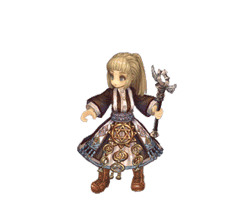

# Kabbalist · Panorama de 2016

[Catálogo de todas as classes](../catalogo-2016.md) · [Diretrizes solo](../../projeto-solo/diretrizes.md)

**Árvore histórica: Cleric · Primeiro rank: 7.**

Suporte de símbolos e números, com reforço de HP, retaliação e cálculo sobre nomes inimigos.

| Visual feminino | Visual masculino |
| :---: | :---: |
|  |  |

*Imagens originais da IMC, preservadas sem alterações. São arquivos do site oficial atual; sua identidade visual exata em 2016 continua em conferência. [Procedência](../../imagens.md).*

## Habilidades e estilo de jogo

| Círculo | Habilidade | Função resumida |
| --- | --- | --- |
| C1 | Revenged Sevenfold | Devolve um ataque inimigo com força multiplicada. |
| C1 | Ein Sof | Círculo que aumenta fortemente o HP máximo. |
| C1 | Merkabah | Invoca uma carruagem divina ofensiva. |
| C1 | Gematria | Calcula um número a partir do nome inimigo. |
| C1 | Notarikon | Calcula um número com as extremidades do nome inimigo. |
| C1 | Reduce Level | Reduz o nível do alvo conforme o número calculado. |

Fonte das habilidades: [F91](../../fontes.md#f91), captura de **2016-03-30**. Os resumos são editoriais e não substituem testes no cliente. O banco contém descrições, não uma garantia de todos os efeitos implementados naquele patch.

## Recorte e versão solo

Esta ficha de panorama inclui os círculos compatíveis com o limite de **Rank 7**, com classes ocultas em C1. Não introduzimos habilidades de círculos de expansão posterior. Nomes históricos foram preservados, inclusive quando a grafia difere de guias ou versões mais novas.

A adaptação solo **removerá classes mágicas**. Esta página preserva o original para consulta; a seleção nominal e o tratamento de híbridos estão nas [diretrizes do projeto](../../projeto-solo/diretrizes.md).
