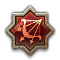
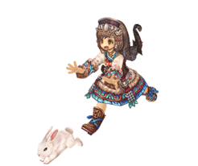
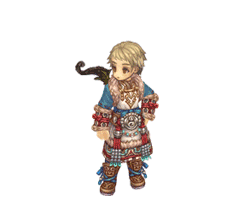

# Mergen · Referência posterior e proposta solo

[Árvore solo de Archer](../catalogo-2016.md?view=solo&base=archer) · [Estudo das seis classes](../../projeto-solo/seis-classes-habilidades-e-circulos.md)

**Referência: página oficial atual, consultada em 15/11/2026. Fora do recorte de março–abril de 2016.** Esta ficha não reconstitui o kit original de lançamento da classe. [F107](../../fontes.md#f107)

Arco de duas mãos e ataques contra grupos.

| Visual feminino | Visual masculino |
| :---: | :---: |
|  |  |

Imagens originais da IMC, preservadas sem alterações; sem confirmação de identidade exata com versões antigas. [Procedência](../../imagens.md).

## Habilidades da referência oficial atual

| Habilidade | Função resumida |
| --- | --- |
| Arrow Sprinkle | Lança uma chuva de flechas em área. |
| Down Fall | Flechas caem sobre um alvo. |
| Targeted Arrow | Dispara várias flechas mirando o inimigo. |
| Triple Arrow | Três flechas explodem ao atingir. |
| Spread Shot | Dispara em leque com ricochetes. |
| Zenith | Treinamento aumenta a área de ataques. |

Fonte: [F107](../../fontes.md#f107). São seis habilidades principais da seção SKILLS, com resumos editoriais. Atributos, Arts, números, equipamento e funcionamento em cliente não foram auditados. Nomes preservados como exibidos, inclusive grafias como Triplet Lense e Tre Granate quando presentes.

## Proposta de reaproveitamento e círculos

**Archer · R6 proposto · até C2 no limite de R7.** As marcações abaixo são avaliação editorial para o projeto solo, não regras do jogo original nem alterações já implementadas. O círculo indica uma sugestão de desbloqueio; habilidades de círculos anteriores continuam acessíveis ao investir mais na classe.

| Habilidade | Círculo proposto | Avaliação | Motivo ou pendência |
| --- | --- | --- | --- |
| Arrow Sprinkle | C2 | Compatível na triagem | Preservar a ideia de uma salva; conferir a origem visual dos projéteis. |
| Down Fall | C2 | Compatível na triagem | Manter disparos balísticos se a animação sustentar a leitura física. |
| Targeted Arrow | C1 | Compatível na triagem | Oferece um ataque dirigido logo no primeiro círculo. |
| Triple Arrow | C2 | Compatível na triagem | Compatível com o critério de combate físico estilizado aceito pelo proprietário. Explosivos, precisão, esquiva e efeitos de combate não são vetados por nome ou exagero visual; números continuam em aberto. |
| Spread Shot | C1 | Compatível na triagem | Compatível com o critério de combate físico estilizado aceito pelo proprietário. Explosivos, precisão, esquiva e efeitos de combate não são vetados por nome ou exagero visual; números continuam em aberto. |
| Zenith | C1 | Compatível na triagem | Preservar como domínio técnico; valores modernos não serão importados. |

Compatível na triagem significa identidade aceita para o estudo, sem certificação de funcionamento no cliente. As quatro habilidades de facas marcadas dependem de animação. Suspensa significa não tratar a habilidade como jogável enquanto a pendência existir. Não copiamos fórmulas atuais para o balanceamento solo.

Mergen começa em R6 nesta proposta: C1 em R6 e C2 mais cedo em R7. **C3 não cabe no recorte atual**; não criamos conteúdo além de R7. A descrição oficial de Zenith menciona Homing Arrow, ausente na lista principal da mesma página; essa divergência foi registrada, sem inventar uma sétima habilidade.

**Próximo passo recomendado:** revisar os efeitos marcados e comparar os pares de rank no [estudo conjunto](../../projeto-solo/seis-classes-habilidades-e-circulos.md) antes de fechar progressão e números.
