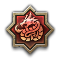
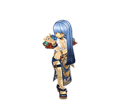
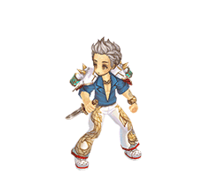

# Outlaw · Referência posterior ao lançamento

[Árvore solo de Scout](../catalogo-2016.md?view=solo&base=scout) · [Estudo de ranks](../../projeto-solo/ranks-e-especializacoes.md)

**Origem: Scout, Re:Build internacional de 15/01/2019. Não pertence ao catálogo de 2016.** [F100](../../fontes.md#f100)

Lutador de rua com provocação, esquiva, areia, tijolos, adaga e pistola.

| Visual feminino | Visual masculino |
| :---: | :---: |
|  |  |

Imagens originais da IMC, preservadas sem alterações. Arquivos oficiais atuais, sem confirmação de identidade exata em 2019. [Procedência](../../imagens.md).

## Habilidades de referência

**Fonte: página oficial atual, consultada em 15/11/2026.** Estes resumos não reconstituem o balanceamento de 2019. Não atribuímos círculos antigos a habilidades posteriores.

| Habilidade | Função resumida |
| --- | --- |
| Aggress | Provoca inimigos e reduz sua esquiva. |
| Brick Smash | Golpe com tijolo que pode atordoar e enfraquece críticos inimigos. |
| Bully | Aumenta a esquiva e a ameaça gerada ao evitar ataques. |
| Blindfire | Disparos que intimidam; compartilha recarga com Mangle. |
| Mangle | Cortes de adaga que intimidam; compartilha recarga com Blindfire. |
| Rampage | Ataque em área com efeitos de esquiva e risco após o uso. |
| Throw Sand | Areia que cega, silencia e prejudica precisão e esquiva. |

Fonte: [F102](../../fontes.md#f102). Resumos editoriais; sem valores numéricos, atributos ou confirmação em cliente.

## Encaixe na versão solo

**Scout · posição proposta.** O rank solo é uma hipótese de organização, não um rank histórico. As duas classes foram adicionadas na atualização que removeu ranks e círculos [F100](../../fontes.md#f100).

O kit original tem recursos físicos e por itens que merecem reaproveitamento. Efeitos de ocultação, invulnerabilidade e demais exceções ainda exigem revisão, seguindo o critério de remover magia. A seleção visual não aprova todas as habilidades.

**Próximo passo recomendado:** conferir o [mapa de ranks e suas hipóteses](../../projeto-solo/ranks-e-especializacoes.md), antes de definir progressão e números.
