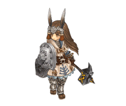
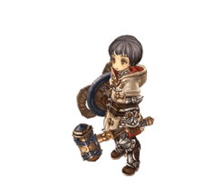

# Paladin · Panorama de 2016

[Catálogo de todas as classes](../catalogo-2016.md) · [Diretrizes solo](../../projeto-solo/diretrizes.md)

**Árvore histórica: Cleric · Primeiro rank: 4.**

Combatente sagrado de impacto, recuperação e proteção elemental, com barreiras e conversão.

| Visual feminino | Visual masculino |
| :---: | :---: |
|  |  |

*Imagens originais da IMC, preservadas sem alterações. São arquivos do site oficial atual; sua identidade visual exata em 2016 continua em conferência. [Procedência](../../imagens.md).*

## Habilidades e estilo de jogo

| Círculo | Habilidade | Função resumida |
| --- | --- | --- |
| C1 | Smite | Pancada forte, favorecida contra demônios e mutantes. |
| C1 | Restoration | Aura que melhora a recuperação de HP próxima. |
| C1 | Resist Elements | Reforça resistências elementais e pode anular ataques. |
| C1 | Turn Undead | Pode derrotar instantaneamente demônios e mutantes. |
| C2 | Conversion | Círculo com chance de converter inimigos. |
| C3 | Barrier | Barreira que afasta inimigos e protege aliados dentro. |
| C3 | Conviction | Pancada que reduz resistências elementais do alvo. |

Fonte das habilidades: [F84](../../fontes.md#f84), captura de **2016-03-31**. Os resumos são editoriais e não substituem testes no cliente. O banco contém descrições, não uma garantia de todos os efeitos implementados naquele patch.

## Recorte e versão solo

Esta ficha de panorama inclui os círculos compatíveis com o limite de **Rank 7**, com classes ocultas em C1. Não introduzimos habilidades de círculos de expansão posterior. Nomes históricos foram preservados, inclusive quando a grafia difere de guias ou versões mais novas.

A adaptação solo **removerá classes mágicas**. Esta página preserva o original para consulta; a seleção nominal e o tratamento de híbridos estão nas [diretrizes do projeto](../../projeto-solo/diretrizes.md).

## Proposta solo em Warrior

O estudo de 15/11/2026 propõe esta classe em Warrior, preservando seu rank histórico como referência. A posição ainda é proposta e o kit contém efeitos sobrenaturais; a transferência não aprova automaticamente todas as habilidades. [Estudo de ranks e reaproveitamento](../../projeto-solo/ranks-e-especializacoes.md).
