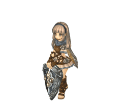
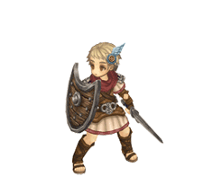

# Peltasta · Panorama de 2016

[Catálogo de todas as classes](../catalogo-2016.md) · [Diretrizes solo](../../projeto-solo/diretrizes.md)

**Árvore histórica: Swordsman · Primeiro rank: 2.**

Especialista em escudo, provocação e bloqueio, capaz de reunir inimigos e proteger sua posição.

| Visual feminino | Visual masculino |
| :---: | :---: |
|  |  |

*Imagens originais da IMC, preservadas sem alterações. São arquivos do site oficial atual; sua identidade visual exata em 2016 continua em conferência. [Procedência](../../imagens.md).*

## Habilidades e estilo de jogo

| Círculo | Habilidade | Função resumida |
| --- | --- | --- |
| C1 | Umbo Blow | Pancada de escudo favorecida após um bloqueio. |
| C1 | Rim Blow | Golpe da borda, favorecido contra congelados ou petrificados. |
| C1 | Swash Buckling | Provoca inimigos próximos para que persigam você. |
| C1 | Guardian | Troca ataque por defesa; incompatível com Gung Ho. |
| C2 | Shield Lob | Arremessa o escudo e perde defesa até recuperá-lo. |
| C2 | High Guard | Postura de bloqueio que sacrifica ataque e crítico. |
| C3 | Butterfly | Sequência de ataques com espada e escudo. |
| C3 | Umbo Thrust | Pancada capaz de anular temporariamente a armadura. |
| C3 | Langort | Bloqueia e ataca com espada e escudo. |

Fonte das habilidades: [F40](../../fontes.md#f40), captura de **2016-04-02**. Os resumos são editoriais e não substituem testes no cliente. O banco contém descrições, não uma garantia de todos os efeitos implementados naquele patch.

## Recorte e versão solo

Esta ficha de panorama inclui os círculos compatíveis com o limite de **Rank 7**, com classes ocultas em C1. Não introduzimos habilidades de círculos de expansão posterior. Nomes históricos foram preservados, inclusive quando a grafia difere de guias ou versões mais novas.

A adaptação solo **removerá classes mágicas**. Esta página preserva o original para consulta; a seleção nominal e o tratamento de híbridos estão nas [diretrizes do projeto](../../projeto-solo/diretrizes.md).
