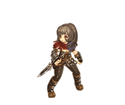
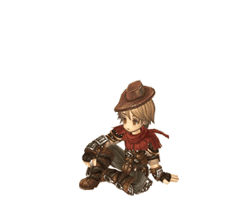

# Rogue · Panorama de 2016

[Catálogo de todas as classes](../catalogo-2016.md) · [Diretrizes solo](../../projeto-solo/diretrizes.md)

**Árvore histórica: Archer · Primeiro rank: 5.**

Emboscador de ataques pelas costas, enganos, adaga e aproveitamento de armadilhas inimigas.

| Visual feminino | Visual masculino |
| :---: | :---: |
|  |  |

*Imagens originais da IMC, preservadas sem alterações. São arquivos do site oficial atual; sua identidade visual exata em 2016 continua em conferência. [Procedência](../../imagens.md).*

## Habilidades e estilo de jogo

| Círculo | Habilidade | Função resumida |
| --- | --- | --- |
| C1 | Sneak Hit | Melhora a chance de crítico ao atacar pelas costas. |
| C1 | Feint | Engana o alvo e reduz sua esquiva. |
| C1 | Capture | Rouba armadilhas e círculos para usá-los depois. |
| C1 | Vendetta | Morte pelo disparo provoca explosão e reforça STR do grupo. |
| C2 | Evasion | Aumenta a esquiva do usuário. |
| C2 | Lachrymator | Lança gás que cega inimigos na área. |
| C2 | Backstab | Golpes de adaga com crítico elevado e possível atordoamento. |
| C3 | Burrow | Esconde no solo; permite atacar sem se mover. |

Fonte das habilidades: [F74](../../fontes.md#f74), captura de **2016-04-01**. Os resumos são editoriais e não substituem testes no cliente. O banco contém descrições, não uma garantia de todos os efeitos implementados naquele patch.

## Recorte e versão solo

Esta ficha de panorama inclui os círculos compatíveis com o limite de **Rank 7**, com classes ocultas em C1. Não introduzimos habilidades de círculos de expansão posterior. Nomes históricos foram preservados, inclusive quando a grafia difere de guias ou versões mais novas.

A adaptação solo **removerá classes mágicas**. Esta página preserva o original para consulta; a seleção nominal e o tratamento de híbridos estão nas [diretrizes do projeto](../../projeto-solo/diretrizes.md).
