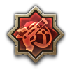
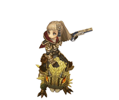
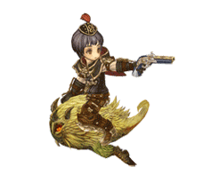

# Schwarzer Reiter · Panorama de 2016

[Catálogo de todas as classes](../catalogo-2016.md) · [Diretrizes solo](../../projeto-solo/diretrizes.md)

**Árvore histórica: Archer · Primeiro rank: 6.**

Atirador montado que usa pistola e besta, mantendo pressão durante avanços e recuos.

| Visual feminino | Visual masculino |
| :---: | :---: |
|  |  |

*Imagens originais da IMC, preservadas sem alterações. São arquivos do site oficial atual; sua identidade visual exata em 2016 continua em conferência. [Procedência](../../imagens.md).*

## Habilidades e estilo de jogo

| Círculo | Habilidade | Função resumida |
| --- | --- | --- |
| C1 | Concentrated Fire | Sequência rápida de tiros contra um alvo. |
| C1 | Caracole | Dispara à frente e recua pelo impulso. |
| C1 | Limacon | Ataca à frente durante manobras montadas. |
| C1 | Retreat Shot | Dispara na direção oposta ao deslocamento. |
| C2 | Wild Shot | Combina tiros de besta e pistola. |

Fonte das habilidades: [F76](../../fontes.md#f76), captura de **2016-03-30**. Os resumos são editoriais e não substituem testes no cliente. O banco contém descrições, não uma garantia de todos os efeitos implementados naquele patch.

## Recorte e versão solo

Esta ficha de panorama inclui os círculos compatíveis com o limite de **Rank 7**, com classes ocultas em C1. Não introduzimos habilidades de círculos de expansão posterior. Nomes históricos foram preservados, inclusive quando a grafia difere de guias ou versões mais novas.

A adaptação solo **removerá classes mágicas**. Esta página preserva o original para consulta; a seleção nominal e o tratamento de híbridos estão nas [diretrizes do projeto](../../projeto-solo/diretrizes.md).
