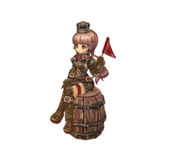
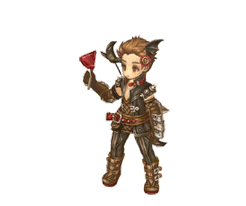

# Scout · Panorama de 2016

[Catálogo de todas as classes](../catalogo-2016.md) · [Diretrizes solo](../../projeto-solo/diretrizes.md)

**Árvore histórica: Archer · Primeiro rank: 4.**

Especialização histórica de Archer: furtividade, reconhecimento, sinalizadores e tiros que ricocheteiam.

| Visual feminino | Visual masculino |
| :---: | :---: |
|  |  |

*Imagens originais da IMC, preservadas sem alterações. São arquivos do site oficial atual; sua identidade visual exata em 2016 continua em conferência. [Procedência](../../imagens.md).*

## Habilidades e estilo de jogo

| Círculo | Habilidade | Função resumida |
| --- | --- | --- |
| C1 | Camouflage | Esconde o usuário num barril e absorve ataques físicos. |
| C1 | Flu Flu | Flecha sonora que assusta inimigos próximos. |
| C1 | Flare Shot | Dispara sinalizador que danifica inimigos na área. |
| C1 | Cloaking | Oculta o usuário até atacar ou saltar. |
| C2 | Perspective Distortion | Permite que aliados ataquem além de seu alcance. |
| C3 | Scan | Revela itens e inimigos escondidos. |
| C3 | Split Arrow | Flecha que ricocheteia para dois inimigos próximos. |

Fonte das habilidades: [F71](../../fontes.md#f71), captura de **2016-04-05**. Os resumos são editoriais e não substituem testes no cliente. O banco contém descrições, não uma garantia de todos os efeitos implementados naquele patch.

## Recorte e versão solo

Esta ficha de panorama inclui os círculos compatíveis com o limite de **Rank 7**, com classes ocultas em C1. Não introduzimos habilidades de círculos de expansão posterior. Nomes históricos foram preservados, inclusive quando a grafia difere de guias ou versões mais novas.

A adaptação solo **removerá classes mágicas**. Esta página preserva o original para consulta; a seleção nominal e o tratamento de híbridos estão nas [diretrizes do projeto](../../projeto-solo/diretrizes.md).

## Triagem de disponibilidade solo

**Revisão de função solo.** Pontos a revisar: Flu Flu, Flare Shot, Cloaking, Perspective Distortion, Split Arrow. Essa triagem não certifica funcionamento em cliente nem altera as habilidades originais acima. [Situação do elenco e pendências](../../projeto-solo/disponibilidade-das-classes.md).
