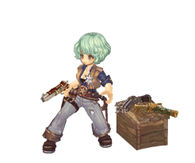
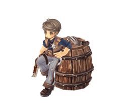

# Sheriff · Referência posterior e proposta solo

[Árvore solo de Scout](../catalogo-2016.md?view=solo&base=scout) · [Estudo das seis classes](../../projeto-solo/seis-classes-habilidades-e-circulos.md)

**Referência: página oficial atual, consultada em 15/11/2026. Fora do recorte de março–abril de 2016.** Esta ficha não reconstitui o kit original de lançamento da classe. [F109](../../fontes.md#f109)

Pistolas, mobilidade, precisão e duelo.

| Visual feminino | Visual masculino |
| :---: | :---: |
|  |  |

Imagens originais da IMC, preservadas sem alterações; sem confirmação de identidade exata com versões antigas. [Procedência](../../imagens.md).

## Habilidades da referência oficial atual

| Habilidade | Função resumida |
| --- | --- |
| Aiming Shot | Tiro inevitável remove benefícios inimigos. |
| Fanning | Dispara alternando pistolas. |
| Peacemaker | Explosivo prejudica o alvo. |
| Quick Draw | Saca e dispara rapidamente. |
| Redemption | Melhora esquiva e movimento. |
| Westraid | Recarga concede acertos garantidos. |

Fonte: [F109](../../fontes.md#f109). São seis habilidades principais da seção SKILLS, com resumos editoriais. Atributos, Arts, números, equipamento e funcionamento em cliente não foram auditados. Nomes preservados como exibidos, inclusive grafias como Triplet Lense e Tre Granate quando presentes.

## Proposta de reaproveitamento e círculos

**Scout · R3 proposto · até C3 no limite de R7.** As marcações abaixo são avaliação editorial para o projeto solo, não regras do jogo original nem alterações já implementadas. O círculo indica uma sugestão de desbloqueio; habilidades de círculos anteriores continuam acessíveis ao investir mais na classe.

| Habilidade | Círculo proposto | Avaliação | Motivo ou pendência |
| --- | --- | --- | --- |
| Aiming Shot | C3 | Revisar | Acerto garantido e remoção genérica de benefícios exigem revisão de regras. |
| Fanning | C2 | Candidata a reaproveitamento | Preservar técnica de disparo; conferir equipamento e animação. |
| Peacemaker | C2 | Revisar | Avaliar explosivo, silêncio e redução de defesa sem presumir que todo efeito já seja mundano. |
| Quick Draw | C1 | Candidata a reaproveitamento | Ataque inicial de pistola com identidade clara. |
| Redemption | C1 | Candidata a reaproveitamento | Tratar como técnica evasiva, conferindo efeitos visuais. |
| Westraid | C3 | Revisar | A recarga é material; a garantia absoluta de acerto precisa ser avaliada. |

Candidata a reaproveitamento significa compatibilidade temática inicial, sujeita à conferência de animação e cliente. Revisar exige decidir efeitos ou regras; suspender significa não tratar a habilidade como jogável enquanto a pendência existir. Não copiamos fórmulas atuais para o balanceamento solo.

**Próximo passo recomendado:** revisar os efeitos marcados e comparar os pares de rank no [estudo conjunto](../../projeto-solo/seis-classes-habilidades-e-circulos.md) antes de fechar progressão e números.
