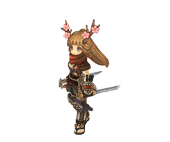
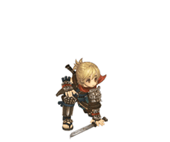

# Shinobi · Panorama de 2016

[Catálogo de todas as classes](../catalogo-2016.md) · [Diretrizes solo](../../projeto-solo/diretrizes.md)

**Árvore histórica: Swordsman · Primeiro rank: 7 · Classe oculta.**

Classe oculta de kunais, clones, contra-ataques e explosões; reúne combate físico e técnicas sobrenaturais.

| Visual feminino | Visual masculino |
| :---: | :---: |
|  |  |

*Imagens originais da IMC, preservadas sem alterações. São arquivos do site oficial atual; sua identidade visual exata em 2016 continua em conferência. [Procedência](../../imagens.md).*

## Habilidades e estilo de jogo

| Círculo | Habilidade | Função resumida |
| --- | --- | --- |
| C1 | Kunai | Arremessa kunais contra múltiplos inimigos. |
| C1 | Bunshin no Jutsu | Cria clones que acompanham ações e habilidades. |
| C1 | Mokuton no Jutsu | Engana o atacante com um tronco e contra-ataca. |
| C1 | Katon no Jutsu | Ataca com explosões de pólvora. |
| C1 | Mijin no Jutsu | Explosão próxima que também fere o próprio usuário. |

Fonte das habilidades: [F51](../../fontes.md#f51), captura de **2016-03-30**. Os resumos são editoriais e não substituem testes no cliente. O banco contém descrições, não uma garantia de todos os efeitos implementados naquele patch.

## Recorte e versão solo

Esta ficha de panorama inclui os círculos compatíveis com o limite de **Rank 7**, com classes ocultas em C1. Não introduzimos habilidades de círculos de expansão posterior. Nomes históricos foram preservados, inclusive quando a grafia difere de guias ou versões mais novas.

A adaptação solo **removerá classes mágicas**. Esta página preserva o original para consulta; a seleção nominal e o tratamento de híbridos estão nas [diretrizes do projeto](../../projeto-solo/diretrizes.md).

## Triagem de disponibilidade solo

**Revisão temática.** Pontos a revisar: Bunshin no Jutsu, Mokuton no Jutsu. Essa triagem não certifica funcionamento em cliente nem altera as habilidades originais acima. [Situação do elenco e pendências](../../projeto-solo/disponibilidade-das-classes.md).
