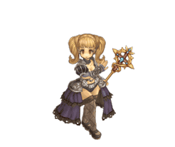
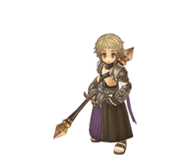

# Sorcerer · Panorama de 2016

[Catálogo de todas as classes](../catalogo-2016.md) · [Diretrizes solo](../../projeto-solo/diretrizes.md)

**Árvore histórica: Wizard · Primeiro rank: 5.**

Invocador de demônios por cartas, com comandos, montaria e controle de suas criaturas.

| Visual feminino | Visual masculino |
| :---: | :---: |
|  |  |

*Imagens originais da IMC, preservadas sem alterações. São arquivos do site oficial atual; sua identidade visual exata em 2016 continua em conferência. [Procedência](../../imagens.md).*

## Habilidades e estilo de jogo

| Círculo | Habilidade | Função resumida |
| --- | --- | --- |
| C1 | Summoning | Invoca um demônio a partir da carta do grimório. |
| C1 | Summon Familiar | Invoca familiares que avançam e explodem no inimigo. |
| C1 | Summon Salamion | Chama um demônio de fogo que acompanha o usuário. |
| C1 | Summon Servant | Chama um servo que oferece efeitos benéficos. |
| C2 | Attack Ground | Ordena ao demônio atacar uma área. |
| C2 | Riding | Permite montar e controlar o demônio invocado. |
| C2 | Morph | Troca a forma invocada pela carta secundária. |
| C2 | Hold | Ordena ao demônio guardar um ponto. |
| C3 | Evocation | Ataca usando o demônio da carta secundária. |
| C3 | Desmodus | Dispara morcegos contra os inimigos. |

Fonte das habilidades: [F60](../../fontes.md#f60), captura de **2016-03-31**. Os resumos são editoriais e não substituem testes no cliente. O banco contém descrições, não uma garantia de todos os efeitos implementados naquele patch.

## Recorte e versão solo

Esta ficha de panorama inclui os círculos compatíveis com o limite de **Rank 7**, com classes ocultas em C1. Não introduzimos habilidades de círculos de expansão posterior. Nomes históricos foram preservados, inclusive quando a grafia difere de guias ou versões mais novas.

A adaptação solo **removerá classes mágicas**. Esta página preserva o original para consulta; a seleção nominal e o tratamento de híbridos estão nas [diretrizes do projeto](../../projeto-solo/diretrizes.md).
