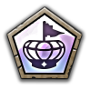
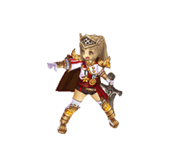
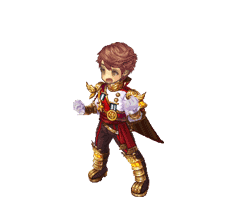

# Templar · Panorama de 2016

[Catálogo de todas as classes](../catalogo-2016.md) · [Diretrizes solo](../../projeto-solo/diretrizes.md)

**Árvore histórica: Swordsman · Primeiro rank: 7.**

Classe voltada à liderança de guilda, com transporte de membros, torre e reforços coletivos.

| Visual feminino | Visual masculino |
| :---: | :---: |
|  |  |

*Imagens originais da IMC, preservadas sem alterações. São arquivos do site oficial atual; sua identidade visual exata em 2016 continua em conferência. [Procedência](../../imagens.md).*

## Habilidades e estilo de jogo

| Círculo | Habilidade | Função resumida |
| --- | --- | --- |
| C1 | Summon Guild Member | Traz um membro da guilda com sua permissão. |
| C1 | Warp To Guild Member | Teleporta até um membro da guilda. |
| C1 | Build Guild Tower | Libera funções da torre e progressão da guilda. |
| C1 | Reduce Craft Time | Bandeira que acelera fabricação perto da torre. |
| C1 | Battle Orders | Aumenta STR dos membros próximos ao líder. |

Fonte das habilidades: [F50](../../fontes.md#f50), captura de **2016-03-30**. Os resumos são editoriais e não substituem testes no cliente. O banco contém descrições, não uma garantia de todos os efeitos implementados naquele patch.

## Recorte e versão solo

Esta ficha de panorama inclui os círculos compatíveis com o limite de **Rank 7**, com classes ocultas em C1. Não introduzimos habilidades de círculos de expansão posterior. Nomes históricos foram preservados, inclusive quando a grafia difere de guias ou versões mais novas.

A adaptação solo **removerá classes mágicas**. Esta página preserva o original para consulta; a seleção nominal e o tratamento de híbridos estão nas [diretrizes do projeto](../../projeto-solo/diretrizes.md).

**Decisão solo de 15/11/2026:** Templar permanece no ramo de combate próximo, originalmente Swordsman. Warrior é o nome provisório sugerido para a base; habilidades ligadas à guilda ainda serão avaliadas para o solo. [Ver seleção consolidada](../../projeto-solo/diretrizes.md).
