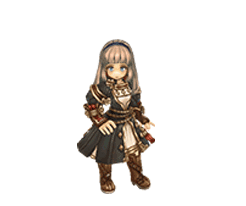
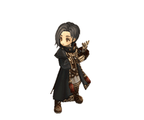

# Thaumaturge · Panorama de 2016

[Catálogo de todas as classes](../catalogo-2016.md) · [Diretrizes solo](../../projeto-solo/diretrizes.md)

**Árvore histórica: Wizard · Primeiro rank: 4.**

Manipula tamanho e atributos de corpos, alterando ataque, resistência e recompensas dos monstros.

| Visual feminino | Visual masculino |
| :---: | :---: |
|  |  |

*Imagens originais da IMC, preservadas sem alterações. São arquivos do site oficial atual; sua identidade visual exata em 2016 continua em conferência. [Procedência](../../imagens.md).*

## Habilidades e estilo de jogo

| Círculo | Habilidade | Função resumida |
| --- | --- | --- |
| C1 | Swell Left Arm | Amplia a mão principal e fortalece o ataque do grupo. |
| C1 | Shrink Body | Reduz o tamanho do alvo. |
| C1 | Swell Body | Aumenta tamanho e HP inimigos, dobrando EXP e saque. |
| C1 | Transpose | Troca INT e CON. |
| C2 | Reversi | Assume controle de um círculo mágico inimigo. |
| C2 | Swell Right Arm | Amplia a mão secundária e melhora seu ataque. |
| C3 | Swell Brain | Aumenta a cabeça e a INT do grupo. |

Fonte das habilidades: [F58](../../fontes.md#f58), captura de **2016-03-31**. Os resumos são editoriais e não substituem testes no cliente. O banco contém descrições, não uma garantia de todos os efeitos implementados naquele patch.

## Recorte e versão solo

Esta ficha de panorama inclui os círculos compatíveis com o limite de **Rank 7**, com classes ocultas em C1. Não introduzimos habilidades de círculos de expansão posterior. Nomes históricos foram preservados, inclusive quando a grafia difere de guias ou versões mais novas.

A adaptação solo **removerá classes mágicas**. Esta página preserva o original para consulta; a seleção nominal e o tratamento de híbridos estão nas [diretrizes do projeto](../../projeto-solo/diretrizes.md).

**Decisão solo de 15/11/2026:** Thaumaturge fica removido da seleção solo. Esta ficha preserva sua referência histórica. [Ver seleção consolidada](../../projeto-solo/diretrizes.md).
