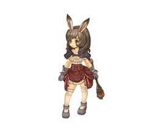

# Wizard · Panorama de 2016

[Catálogo de todas as classes](../catalogo-2016.md) · [Diretrizes solo](../../projeto-solo/diretrizes.md)

**Árvore histórica: Wizard · Primeiro rank: 1.**

Base de magia, proteção e controle, com opções posteriores para acelerar ou sustentar a conjuração.

| Visual feminino | Visual masculino |
| :---: | :---: |
|  |  |

*Imagens originais da IMC, preservadas sem alterações. São arquivos do site oficial atual; sua identidade visual exata em 2016 continua em conferência. [Procedência](../../imagens.md).*

## Habilidades e estilo de jogo

| Círculo | Habilidade | Função resumida |
| --- | --- | --- |
| C1 | Energy Bolt | Projétil mágico cujo dano cresce com a carga. |
| C1 | Lethargy | Aplica letargia ao inimigo. |
| C1 | Sleep | Adormece o alvo até o limite de ataques recebidos. |
| C1 | Reflect Shield | Escudo protetor que reflete dano ao agressor. |
| C1 | Earthquake | Abalo mágico de terra à frente. |
| C2 | Surespell | Protege a conjuração contra interrupções por ataques. |
| C3 | Magic Missile | Dispara projéteis mágicos que geram novos acertos. |
| C3 | Quick Cast | Reduz o tempo de conjuração. |

Fonte das habilidades: [F52](../../fontes.md#f52), captura de **2016-04-02**. Os resumos são editoriais e não substituem testes no cliente. O banco contém descrições, não uma garantia de todos os efeitos implementados naquele patch.

## Recorte e versão solo

Esta ficha de panorama inclui os círculos compatíveis com o limite de **Rank 7**, com classes ocultas em C1. Não introduzimos habilidades de círculos de expansão posterior. Nomes históricos foram preservados, inclusive quando a grafia difere de guias ou versões mais novas.

A adaptação solo **removerá classes mágicas**. Esta página preserva o original para consulta; a seleção nominal e o tratamento de híbridos estão nas [diretrizes do projeto](../../projeto-solo/diretrizes.md).

[Abrir a ficha já pesquisada de Wizard](../wizard.md).
