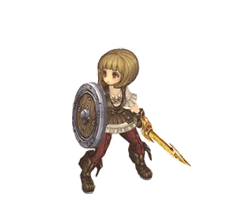

# Swordsman · Espadachim

[Classes](README.md) · [Próxima: Wizard](wizard.md)

| Visual feminino | Visual masculino |
| :---: | :---: |
|  |  |

*Imagens originais da IMC Games, obtidas no site oficial atual. A aparência exata desses arquivos em 2016 ainda precisa de comprovação. [Procedência](../imagens.md).*

## Identidade no lançamento

**Revisão documental de 15/11/2026 · iToS, janela de março–abril de 2016.** Swordsman era a entrada da árvore de combate próximo. Seu primeiro círculo era obrigatório; investir em C2/C3 competia com avanços em outras classes. Não havia uma ficha isolada que descrevesse toda a build. [F03](../fontes.md#f03)

Esta revisão aprofunda as oito habilidades e acrescenta 100 linhas por nível, 13 atributos de habilidades e seis atributos gerais preservados em nove capturas de 2016. Ela ainda não é uma transcrição completa do cliente de 29/03/2016: valores sem evidência permanecem em aberto. O [registro estruturado da classe](../../data/classes/swordsman.json) distingue relatos do período de números ainda não auditados.

## Habilidades por círculo

| Desbloqueio | Habilidade | Função histórica resumida |
| --- | --- | --- |
| C1 | Thrust | Perfuração (Pierce); relatado sem recarga no início de iToS. |
| C1 | Bash | Golpe cuja derrubada dependia de atributo. |
| C1 | Gung Ho | Bônus fixo de ataque físico, com redução de defesa. |
| C1 | Concentrate | Bônus de dano limitado por acertos, sem a penalidade defensiva de Gung Ho. |
| C1 | Pain Barrier | Resistência a knockback, knockdown e stagger; não confundir com imunidade geral a estados. |
| C2 | Restrain | Possibilidade de aplicar atordoamento. |
| C2 | Pommel Beat | Golpe do tipo Strike. |
| C3 | Double Slash | Ataque com interação com alvos sangrando. |

**Evidência:** C1 em [F02](../fontes.md#f02), C2/C3 em [F03](../fontes.md#f03). O autor Autentist também relaciona Bash a controle e Pain Barrier à proteção de ataques canalizados. Isso não torna todas as recomendações de build desses guias regras obrigatórias. [F09](../fontes.md#f09)

## Atributos documentados

| Atributo | O que conseguimos sustentar | O que continua pendente |
| --- | --- | --- |
| Weapon Swap | Troca rápida de conjunto de armas. | Custo, tempo e requisitos da edição exata. |
| Bash: Knockdown | Acrescentava derrubada; exigia Bash nível 3. | Custo de aprendizado e conferência no cliente. |
| Gung Ho: Enhance | A captura registra +1 ao bônus de ataque e à penalidade de defesa por nível de atributo. | Custos históricos e conferência no cliente. |
| Concentrate: Enhance | A captura registra +2 ao bônus por nível de atributo. | Custos históricos e conferência no cliente. |

Os quatro atributos são citados no guia Rank 1 and You; os valores de aprimoramento vêm das capturas históricas, detalhadas nas [tabelas recuperadas](swordsman-valores-2016.md). Não usamos as porcentagens da página oficial atual para preencher os campos antigos. [F02](../fontes.md#f02) · [F20](../fontes.md#f20) · [F21](../fontes.md#f21)

## Relatos contemporâneos e conferência das capturas

| Dado | Valor relatado | Origem e limite da afirmação |
| --- | --- | --- |
| Recarga de Thrust | 0 s | Relato de abril de 2016; ainda sem snapshot do primeiro patch. [F02](../fontes.md#f02) |
| Requisito de Bash: Knockdown | Bash nível 3 | Corroborado por guias distintos. [F02](../fontes.md#f02) · [F09](../fontes.md#f09) |
| Overheat de Bash | 3 usos | Registrado por Cathexis; evidência documental, sem auditoria do cliente. [F03](../fontes.md#f03) |
| Pain Barrier em exemplos de C2 / C3 | Níveis 10 / 15 | Níveis usados no manual, não uma recomendação universal de distribuição. [F03](../fontes.md#f03) |
| Restrain em exemplos de C2 / C3 | Níveis 5 / 10 | Mesmo limite documental. [F03](../fontes.md#f03) |

**Tabelas recuperadas:** [valores por nível e atributos de Swordsman em 2016](swordsman-valores-2016.md). As capturas acrescentam ataque exibido, SP, recarga, duração e outros campos disponíveis por habilidade. Não confundir números exibidos pelo banco com testes de implementação no cliente. Preços, tempos de aprendizado e requisitos ainda não encontrados continuam em aberto.

## Oito capturas, sem misturar épocas

As fontes F18–F25 cobrem 31/03 a 15/04/2016. Foram recuperadas as tabelas completas exibidas pelo banco, mas cada uma conserva sua data e não é apresentada como um mesmo build. O manifesto registra URLs e hashes dos HTMLs consultados. [Abrir as tabelas](swordsman-valores-2016.md).

## Armas, sobrevivência e próximos avanços

A árvore incluía especializações com requisitos próprios. Um exemplo de Autentist combina Swordsman C1, Highlander C3, Hoplite C2 e Dragoon C1. O uso de armas e as sinergias são discutidos no contexto do caminho inteiro; isso não prova que Swordsman C1, sozinho, equipasse qualquer arma da árvore. [F09](../fontes.md#f09)

A matriz de armas da classe inicial, a localização e a identidade do mestre, e as condições da missão de avanço continuam em conferência. Não importamos essa matriz de um emulador atual.

## O que mudou na classe atual

A página oficial consultada em 15/11/2026 lista **Bash, Bear, Gung Ho, Liberate, Pain Barrier e Thrust**. Concentrate, Restrain, Pommel Beat e Double Slash não aparecem nesse kit de Swordsman. Isso comprova uma diferença da ficha exibida, não que todas essas habilidades tenham sido eliminadas de todo o jogo. [F10](../fontes.md#f10)

O mesmo nome também não garante a mesma regra: efeitos adicionais de Pain Barrier, por exemplo, não devem ser transferidos para a versão histórica. A mudança estrutural é maior: Swordsman C2/C3 deixou de ser uma escolha no modelo de avanço do Re:Build. [Entenda a evolução das classes](../historia/evolucao-das-classes.md).

## O que falta preservar

- Limites, custos e tempos dos atributos, além do que está descrito nas capturas.
- Validar no cliente da edição as tabelas recuperadas e as interações descritas.
- Equipamentos permitidos, NPC mestre e missão de avanço.
- Diferenças em relação aos betas de 2015.

**Leitura para o futuro solo:** a utilidade de resistência a interrupções merece testes de campo. Isso é uma pauta de adaptação futura, não uma mudança desta ficha histórica.

**Próximo passo recomendado:** conferir armas permitidas, mestre e missão de avanço de Swordsman em fontes da mesma época. Depois, aplicar o modelo de capturas a Highlander e Peltasta.
