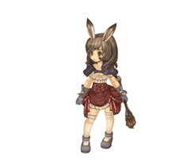

# Wizard · Mago

[Classes](README.md) · [Anterior: Swordsman](swordsman.md) · [Próxima: Archer](archer.md)

| Visual feminino | Visual masculino |
| :---: | :---: |
|  |  |

*Imagens originais da IMC Games, obtidas no site oficial atual. A aparência exata desses arquivos em 2016 ainda precisa de comprovação. [Procedência](../imagens.md).*

## Identidade no lançamento

A base de magia combinava ataques e controle. Guias de abril descrevem a importância de novos recursos de conjuração ao investir em C2 e C3. Essa documentação retrata o período inicial; não constitui um snapshot do patch de 29/03. [F02](../fontes.md#f02) · [F05](../fontes.md#f05)

## Habilidades por círculo

| Desbloqueio | Habilidade | Função histórica resumida |
| --- | --- | --- |
| C1 | Energy Bolt | Projétil mágico com carregamento. |
| C1 | Lethargy | Enfraquecimento com interações de dano. |
| C1 | Sleep | Controle por sono. |
| C1 | Reflect Shield | Recurso defensivo; funcionamento variou entre betas e lançamento. |
| C1 | Earthquake | Ataque com deslocamento de inimigos. |
| C2 | Surespell | Apoio à conjuração contra interrupções por ataques. |
| C3 | Magic Missile | Ataque mágico usado nas rotas de Wizard C3. |
| C3 | Quick Cast | Redução de tempo de conjuração; havia atributo de dano mágico. |

**Evidência:** C1 em [F02](../fontes.md#f02); progressão C2/C3 em [F05](../fontes.md#f05). A ficha não transforma recomendações de uma build Wizard/Elementalist/Warlock em uma obrigação de classe.

## Um cuidado com a memória do beta

O guia Rank 1 and You distingue explicitamente o Reflect Shield dos testes anteriores de seu comportamento no lançamento. Por isso, a memória de uma versão muito poderosa da habilidade não será aplicada automaticamente à edição internacional. [F02](../fontes.md#f02)

## O que falta preservar

- Fórmulas, atributos e valores exatos do patch de referência.
- Condições e exceções de interrupção de conjuração.
- Requisitos de equipamento, mestre e missão de avanço.
- Uma comparação documentada do Reflect Shield entre cada beta e o lançamento.
