# Catálogo de chefes

[Revisão dos chefes](revisao.md)

Os **62 chefes** que eram demônios em 2016, agrupados pelo retrato e organizados pela proposta de papel na história sem sobrenatural. Cada chefe tem uma página com retrato, proposta e textos de 2016.

**Revisão:** 0 aprovados, 0 rejeitados, 62 pendentes. Para aprovar ou rejeitar, use a [revisão dos chefes](revisao.md).

Retratos do jogo atual coletados da base de fãs tos.guru, sem alteração; identidade com 2016 não verificada. [F141](../../fontes.md#f141)

## Humanos (aparência humana, armadura, elmo ou capuz)

Generais, oficiais e soldados do reino rival sem mudar o sprite. Prison Cutter usa máscara de gás; Riteris e Ignas parecem cavaleiros.

| Retrato | Chefe | Nível | Revisão |
| --- | --- | --- | --- |
| 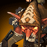 | [Templeshooter](templeshooter.md) | — | Pendente |
| 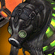 | [Prison Cutter](prisoncutter.md) | — | Pendente |
| 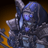 | [Ignas](ignas.md) | — | Pendente |
| 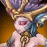 | [Merregina](merregina.md) | 46 | Pendente |
| 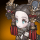 | [Gesti](gesti.md) | 50 | Pendente |
| 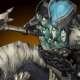 | [Dullahan](durahan.md) | 86, 185 | Pendente |
| 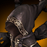 | [Rexipher](lecifer.md) | 96 | Pendente |
| 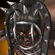 | [Zaura](zawra.md) | 103 | Pendente |
| 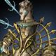 | [Riteris](riteris.md) | 142 | Pendente |
| 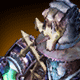 | [Blue Riteris](riteris-blue.md) | 142 | Pendente |
| 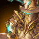 | [Brown Riteris](riteris-brown.md) | 142 | Pendente |
| 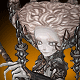 | [Naktis](naktis.md) | 145 | Pendente |
| 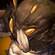 | [Demon Lord Blut](blud.md) | 153 | Pendente |
| 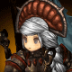 | [Nebulas](chiefguard.md) | 272 | Pendente |

## Humanos mutados (pele ou traços alterados)

Generais e campeões alterados pelos cristais da Árvore.

| Retrato | Chefe | Nível | Revisão |
| --- | --- | --- | --- |
| 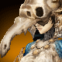 | [Harpeia](harpeia.md) | 52, 55, 122 | Pendente |
| 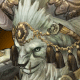 | [Hauberk](hauberk.md) | — | Pendente |
| 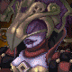 | [Mirtis](mirtis.md) | 22 | Pendente |
| 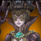 | [Deathweaver](deathweaver.md) | 53 | Pendente |
| 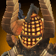 | [Tomb Lord](tomblord.md) | 67 | Pendente |
| 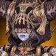 | [Helgasercle](helgasercle.md) | 126 | Pendente |
| 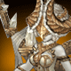 | [Demon Lord Nuaele](nuaelle.md) | 156 | Pendente |

## Criaturas mutadas

Bestas transformadas pela Árvore. Marnox pode ser um humano que virou fera.

| Retrato | Chefe | Nível | Revisão |
| --- | --- | --- | --- |
| 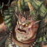 | [Lithorex](lithorex.md) | — | Pendente |
| 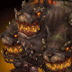 | [Cerberus](kerberos.md) | 200 | Pendente |
| 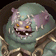 | [Abomination](abomination.md) | — | Pendente |
| 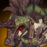 | [Unicorn](unicorn.md) | — | Pendente |
| 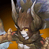 | [Nuodai](nuodai.md) | — | Pendente |
| 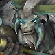 | [Centaurus](centaurus.md) | — | Pendente |
| 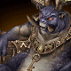 | [Turtai](turtai.md) | — | Pendente |
| 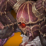 | [Belian](belian.md) | — | Pendente |
| 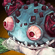 | [Progola](frogola.md) | — | Pendente |
| 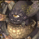 | [Cyclops](strongholder.md) | 17 | Pendente |
| 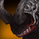 | [Dionys](dionys.md) | 21, 159 | Pendente |
| 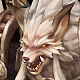 | [Demon Lord Marnox](marnoks.md) | 28 | Pendente |
| 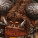 | [Minotaur](minotaurs.md) | 31, 33, 102, 116 | Pendente |
| 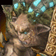 | [Gargoyle](gargoyle-q1.md) | 38, 199 | Pendente |
| 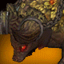 | [Gorgon](gorgon.md) | 70 | Pendente |
| 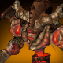 | [Red Lavenzard](rambandgad-red.md) | 87 | Pendente |
| 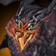 | [Drapeliun](drapeliun.md) | 90 | Pendente |
| 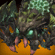 | [Throneweaver](throneweaver.md) | 109, 129 | Pendente |
| 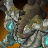 | [Lavenzard](rambandgad-q1.md) | 250 | Pendente |

## Ligados à Árvore e às plantas

Encaixam diretamente: brotos e raízes da Árvore.

| Retrato | Chefe | Nível | Revisão |
| --- | --- | --- | --- |
| 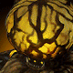 | [Wriggling Lutopus](rootopus.md) | — | Pendente |
| 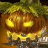 | [Jack O'Lantern](jacko-lantern.md) | — | Pendente |
| 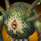 | [Velorchard](velorchard.md) | — | Pendente |

## Criaturas de fogo

Decidir: mutação por cristais que queimam, ou fora.

| Retrato | Chefe | Nível | Revisão |
| --- | --- | --- | --- |
| 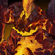 | [Pyroego](pyroego.md) | — | Pendente |
| 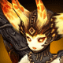 | [Flammidus](flammidus.md) | — | Pendente |
| 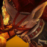 | [Fire Lord](fireload.md) | 127 | Pendente |

## Autômatos e estátuas

Decidir: máquinas de guerra do reino rival ou fora. Corrupted é uma estátua animada, ligada ao tema das estátuas que saem.

| Retrato | Chefe | Nível | Revisão |
| --- | --- | --- | --- |
| 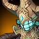 | [Tomb Maiden](tombmaiden.md) | — | Pendente |
| 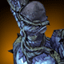 | [Blue Corrupted](fallen-statue-blue.md) | — | Pendente |
| 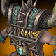 | [Unknocker](unknocker.md) | 41 | Pendente |
| 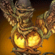 | [Corrupted](fallen-statue-q1.md) | 53 | Pendente |
|  | [Marionette](marionette.md) | 181 | Pendente |

## Encapuzados (parecem fantasmas, mas têm forma humana)

Proposta: membros da Ordem da Árvore da Verdade, a seita que já existe nos textos de 2016.

| Retrato | Chefe | Nível | Revisão |
| --- | --- | --- | --- |
|  | [Specter Monarch](spector-m-q1.md) | 13 | Pendente |
|  | [Grim Reaper](grimreaper.md) | — | Pendente |
|  | [Specter of Deceit](spector-f.md) | 18 | Pendente |
|  | [Chapparition](chapparition.md) | 39 | Pendente |
|  | [Necroventer](necrovanter.md) | 49 | Pendente |
|  | [Rikaus](spector-gh.md) | 61 | Pendente |

## Sobrenaturais demais

Proposta: deixar de fora ou reaproveitar só o modelo em outro contexto.

| Retrato | Chefe | Nível | Revisão |
| --- | --- | --- | --- |
|  | [Master Genie](genmagnus.md) | — | Pendente |
|  | [Ellaganos](ellaganos.md) | — | Pendente |
|  | [Shadowgaler](shadowgaoler.md) | 18 | Pendente |
|  | [Mummyghast](mummyghast.md) | 46 | Pendente |

## Sem imagem

Conferir no jogo.

| Retrato | Chefe | Nível | Revisão |
| --- | --- | --- | --- |
|  | [Gorkas](swordballista.md) | 83, 109, 112 | Pendente |
