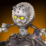

# Ellaganos

[Catálogo de chefes](README.md) · [Revisão dos chefes](revisao.md)

| Campo | Valor |
| --- | --- |
| Nomes nos dados | Ellaganos |
| Nível | — |
| Raça em 2016 | Demônio (Velnias) |
| Grupo proposto | Sobrenaturais demais |
| Revisão do proprietário | **Pendente** |

## Proposta para o projeto

Proposta: deixar de fora ou reaproveitar só o modelo em outro contexto.

## Imagem

Retrato do jogo atual, coletado da base de fãs tos.guru. A identidade com 2016 não foi verificada, e o modelo 3D pode mostrar detalhes que o retrato não mostra. [F141](../../fontes.md#f141) Procedência em `data/boss-assets.json`.
