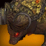

# Gorgon

[Catálogo de chefes](README.md) · [Revisão dos chefes](revisao.md)

| Campo | Valor |
| --- | --- |
| Nomes nos dados | Gorgon |
| Nível | 70 |
| Raça em 2016 | Demônio (Velnias) |
| Grupo proposto | Criaturas mutadas |
| Revisão do proprietário | **Pendente** |

## Proposta para o projeto

Bestas transformadas pela Árvore. Marnox pode ser um humano que virou fera.

## Textos de 2016

> You defeated the Gorgon?  Wow, Revelators must be some sort of superhuman.
> You've defeated the Gorgon that routed Dennis' colleagues. Tell this to Dennis.

Trechos da tradução oficial de 15/04/2016. [F140](../../fontes.md#f140)

## Imagem

Retrato do jogo atual, coletado da base de fãs tos.guru. A identidade com 2016 não foi verificada, e o modelo 3D pode mostrar detalhes que o retrato não mostra. [F141](../../fontes.md#f141) Procedência em `data/boss-assets.json`.
