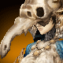

# Harpeia

[6.3 Catálogo de chefes](README.md) · [6.2 Chefes da história](../chefes-da-historia.md) · [Revisar na página inicial](../../../README.md#revisao-chefes)

| Campo | Valor |
| --- | --- |
| Nomes nos dados | Corpse Cleaner Harpeia, Orange Harpeia, White Harpeia, Harpeia, Q1 Harpeia |
| Nível | 52, 55, 122 |
| Raça em 2016 | Demônio (Velnias) |
| Grupo proposto | Humanos mutados (pele ou traços alterados) |
| Revisão do proprietário | **Pendente** |

## Proposta para o projeto

Generais e campeões alterados pelos cristais da Árvore.

## Imagem

Retrato do jogo atual, coletado da base de fãs tos.guru. A identidade com 2016 não foi verificada, e o modelo 3D pode mostrar detalhes que o retrato não mostra. [F141](../../fontes.md#f141) Procedência em `data/boss-assets.json`.
