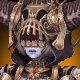

# Helgasercle

[Catálogo de chefes](README.md) · [Revisão dos chefes](revisao.md)

| Campo | Valor |
| --- | --- |
| Nomes nos dados | Helgasercle |
| Nível | 126 |
| Raça em 2016 | Demônio (Velnias) |
| Grupo proposto | Humanos mutados (pele ou traços alterados) |
| Revisão do proprietário | **Pendente** |

## Proposta para o projeto

**General de Giltine.** Comandante de alta patente

## Na história de 2016

Senhor demônio poderoso [F140](../../fontes.md#f140)

## Textos de 2016

> Is Helgasercle attacking again?  If that's the case, this battle will be a very long one...
> Destroy all the Magic Suppressors that Helgasercle prepared on the 5th floor of the Mage Tower.

Trechos da tradução oficial de 15/04/2016. [F140](../../fontes.md#f140)

## Imagem

Retrato do jogo atual, coletado da base de fãs tos.guru. A identidade com 2016 não foi verificada, e o modelo 3D pode mostrar detalhes que o retrato não mostra. [F141](../../fontes.md#f141) Procedência em `data/boss-assets.json`.
