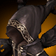

# Rexipher

[Catálogo de chefes](README.md) · [Revisão dos chefes](revisao.md)

| Campo | Valor |
| --- | --- |
| Nomes nos dados | Rexipher |
| Nível | 96 |
| Raça em 2016 | Demônio (Velnias) |
| Grupo proposto | Humanos (aparência humana, armadura, elmo ou capuz) |
| Revisão do proprietário | **Pendente** |

## Proposta para o projeto

**General de Giltine.** Estrategista do reino rival

## Na história de 2016

O mais sábio dos senhores demônios, mal aproveitado por Gesti [F140](../../fontes.md#f140)

## Textos de 2016

> Hmm.. where is this place? What about Rexipher? Where is he?
> Rexipher? I am not sure. Are you sure that's the correct name?

Trechos da tradução oficial de 15/04/2016. [F140](../../fontes.md#f140)

## Imagem

Retrato do jogo atual, coletado da base de fãs tos.guru. A identidade com 2016 não foi verificada, e o modelo 3D pode mostrar detalhes que o retrato não mostra. [F141](../../fontes.md#f141) Procedência em `data/boss-assets.json`.
