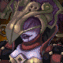

# Mirtis

[6.3 Catálogo de chefes](README.md) · [6.2 Chefes da história](../chefes-da-historia.md) · [Revisar na página inicial](../../../README.md#revisao-chefes)

| Campo | Valor |
| --- | --- |
| Nomes nos dados | Mirtis |
| Nível | 22 |
| Raça em 2016 | Demônio (Velnias) |
| Grupo proposto | Humanos mutados (pele ou traços alterados) |
| Revisão do proprietário | **Pendente** |

## Proposta para o projeto

**General de Giltine.** Agente fracassada tentando recuperar prestígio

## Na história de 2016

Senhora demônio de baixa posição, falhou missões de Giltine [F140](../../fontes.md#f140)

## Textos de 2016

> However, Mirtis was too strong and Cunningham had to make a tough decision.
> In the end, Cunningham destroyed the mines, sealing Mirtis and himself in it.

Trechos da tradução oficial de 15/04/2016. [F140](../../fontes.md#f140)

## Imagem

Retrato do jogo atual, coletado da base de fãs tos.guru. A identidade com 2016 não foi verificada, e o modelo 3D pode mostrar detalhes que o retrato não mostra. [F141](../../fontes.md#f141) Procedência em `data/boss-assets.json`.
