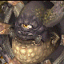

# Cyclops

[6.3 Catálogo de chefes](README.md) · [6.2 Chefes da história](../chefes-da-historia.md) · [Revisar na página inicial](../../../README.md#revisao-chefes)

| Campo | Valor |
| --- | --- |
| Nomes nos dados | Cyclops |
| Nível | 17 |
| Raça em 2016 | Demônio (Velnias) |
| Grupo proposto | Criaturas mutadas |
| Revisão do proprietário | **Pendente** |

## Proposta para o projeto

Bestas transformadas pela Árvore. Marnox pode ser um humano que virou fera.

## Textos de 2016

> Removed the barrier that was blocking the way to the 1st floor and defeated the Cyclops. Look for Vaidutis, who ran away to the 1st floor.

Trechos da tradução oficial de 15/04/2016. [F140](../../fontes.md#f140)

## Imagem

Retrato do jogo atual, coletado da base de fãs tos.guru. A identidade com 2016 não foi verificada, e o modelo 3D pode mostrar detalhes que o retrato não mostra. [F141](../../fontes.md#f141) Procedência em `data/boss-assets.json`.
