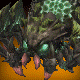

# Throneweaver

[6.3 Catálogo de chefes](README.md) · [6.2 Chefes da história](../chefes-da-historia.md) · [Revisar na página inicial](../../../README.md#revisao-chefes)

| Campo | Valor |
| --- | --- |
| Nomes nos dados | Throneweaver, Yellow Throneweaver |
| Nível | 109, 129 |
| Raça em 2016 | Demônio (Velnias) |
| Grupo proposto | Criaturas mutadas |
| Revisão do proprietário | **Pendente** |

## Proposta para o projeto

Bestas transformadas pela Árvore. Marnox pode ser um humano que virou fera.

## Textos de 2016

> The Throneweaver appeared when you touched the collapsed sculpture!
> You have collected enough Ridimed Leaves that the Throneweaver likes. Return to the Sad Owl.

Trechos da tradução oficial de 15/04/2016. [F140](../../fontes.md#f140)

## Imagem

Retrato do jogo atual, coletado da base de fãs tos.guru. A identidade com 2016 não foi verificada, e o modelo 3D pode mostrar detalhes que o retrato não mostra. [F141](../../fontes.md#f141) Procedência em `data/boss-assets.json`.
