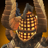

# Tomb Lord

[Catálogo de chefes](README.md) · [Revisão dos chefes](revisao.md)

| Campo | Valor |
| --- | --- |
| Nomes nos dados | Tomb Lord |
| Nível | 67 |
| Raça em 2016 | Demônio (Velnias) |
| Grupo proposto | Humanos mutados (pele ou traços alterados) |
| Revisão do proprietário | **Pendente** |

## Proposta para o projeto

Generais e campeões alterados pelos cristais da Árvore.

## Textos de 2016

> You defeated the Tomb Lord that interfered. Now, go find the secret treasure.
> A monster interfered as you were about to find the secret treasure of the Royal Mausoleum. Defeat Tomb Lord.

Trechos da tradução oficial de 15/04/2016. [F140](../../fontes.md#f140)

## Imagem

Retrato do jogo atual, coletado da base de fãs tos.guru. A identidade com 2016 não foi verificada, e o modelo 3D pode mostrar detalhes que o retrato não mostra. [F141](../../fontes.md#f141) Procedência em `data/boss-assets.json`.
