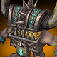

# Unknocker

[6.3 Catálogo de chefes](README.md) · [6.2 Chefes da história](../chefes-da-historia.md) · [Revisar na página inicial](../../../README.md#revisao-chefes)

| Campo | Valor |
| --- | --- |
| Nomes nos dados | Unknocker |
| Nível | 41 |
| Raça em 2016 | Demônio (Velnias) |
| Grupo proposto | Autômatos e estátuas |
| Revisão do proprietário | **Pendente** |

## Proposta para o projeto

Decidir: máquinas de guerra do reino rival ou fora. Corrupted é uma estátua animada, ligada ao tema das estátuas que saem.

## Textos de 2016

> An Unknocker suddenly appeared! The Unknocker may have the documents, so defeat it!
> You defeated the Unknocker that was guarding the altar. Talk to Follower Tomas again.

Trechos da tradução oficial de 15/04/2016. [F140](../../fontes.md#f140)

## Imagem

Retrato do jogo atual, coletado da base de fãs tos.guru. A identidade com 2016 não foi verificada, e o modelo 3D pode mostrar detalhes que o retrato não mostra. [F141](../../fontes.md#f141) Procedência em `data/boss-assets.json`.
