# Seis classes: habilidades, reaproveitamento e círculos

[Árvores solo](../classes/catalogo-2016.md) · [Mapa de ranks](ranks-e-especializacoes.md) · [Diretrizes](diretrizes.md)

**Estudo de 15/11/2026.** O proprietário escolheu Appraiser, Mergen e Arbalester para Archer; Ardito, Sheriff e Clown para Scout. Esta etapa reúne **18 imagens oficiais originais e 36 habilidades principais** das seis páginas atuais da IMC. Ranks, círculos e avaliações abaixo são propostas para revisão; não são conteúdo já implementado no jogo.

## Referências e limites

O inventário está em [classes-later.json](../../data/catalog/classes-later.json), separado das 55 classes e 382 habilidades da janela de março–abril de 2016. Algumas referências posteriores podem ter existido antes do Re:Build; estar neste conjunto não significa que a classe nasceu sem ranks. A data de introdução das seis candidatas não foi conferida neste estudo e não foi inventada.

As imagens foram baixadas do site oficial atual, sem alterações, com URL, tamanho e SHA-256 no [manifesto](../../data/assets.json). Não há comprovação de identidade exata com arquivos antigos. As capturas das páginas têm hashes em [later-snapshots.json](../../data/research/later-snapshots.json). Nenhum arquivo do cliente foi testado.

As listas cobrem a seção **SKILLS** das páginas consultadas. Não são auditoria completa de atributos, Arts, equipamento, missões ou fórmulas. Os números atuais não preenchem tabelas históricas. As propostas ficam em [six-classes-solo.json](../../data/proposals/six-classes-solo.json), sem atribuir círculos históricos às referências atuais.

## Panorama visual e fichas

| Classe | Visual oficial feminino | Visual oficial masculino | Referência e inventário |
| --- | :---: | :---: | --- |
| **Appraiser** | 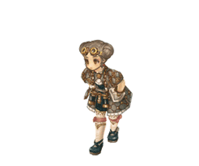 | 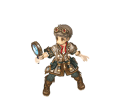 | [Seis habilidades e avaliação](../classes/catalogo/appraiser.md) · [F106](../fontes.md#f106) |
| **Mergen** | 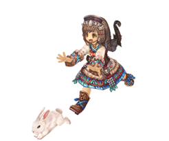 | 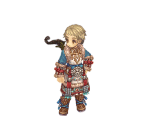 | [Seis habilidades e avaliação](../classes/catalogo/mergen.md) · [F107](../fontes.md#f107) |
| **Arbalester** | 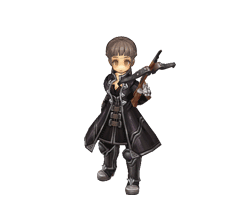 | 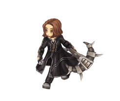 | [Seis habilidades e avaliação](../classes/catalogo/arbalester.md) · [F103](../fontes.md#f103) |
| **Ardito** | 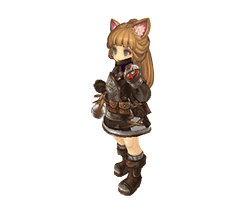 | 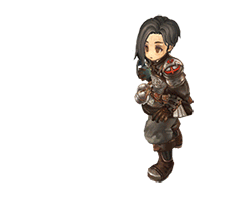 | [Seis habilidades e avaliação](../classes/catalogo/ardito.md) · [F108](../fontes.md#f108) |
| **Sheriff** | 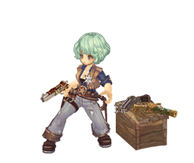 | 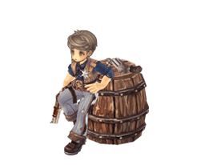 | [Seis habilidades e avaliação](../classes/catalogo/sheriff.md) · [F109](../fontes.md#f109) |
| **Clown** | 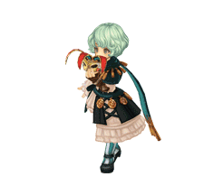 | 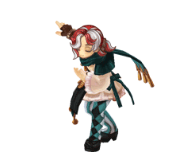 | [Seis habilidades e avaliação](../classes/catalogo/clown.md) · [F110](../fontes.md#f110) |

## Como avaliar a ausência de magia

- **Candidata a reaproveitamento:** identidade material ou técnica, sujeita à conferência de animações, regras e cliente.
- **Revisar:** o ataque ou tema é aproveitável, mas uma interação, efeito ou explicação precisa ser avaliada.
- **Suspender por enquanto:** não tratar como habilidade jogável até resolver uma incompatibilidade. A marcação de círculo experimental não muda essa situação.

Dano elemental não prova magia sozinho: granadas e combustível podem produzir fogo. Da mesma forma, esquiva com uma breve janela de proteção pode ser uma abstração de combate; ela não exige automaticamente excluir uma classe. A avaliação considera o efeito e sua apresentação. Não basta renomear um feitiço para torná-lo físico.

A triagem editorial das 36 habilidades resultou em **19 candidatas a reaproveitamento, 16 para revisão e uma suspensa**. Esses números não representam uma validação em cliente.

**Achados principais:** Recupero, de Ardito, já oferece autocura por seringa; não é cura de grupo. Triplet Lense, de Appraiser, usa lentes autônomas e fica suspensa. Guiagem de Arbalester, ativações de facas no chão de Clown e acertos garantidos/remoção de benefícios de Sheriff exigem inspeção. Não foram criadas habilidades substitutas.

## Proposta de pares e identidade

| Candidata | Rank solo proposto | Par no mesmo rank | Motivo de organização |
| --- | --- | --- | --- |
| Clown | Scout R2 | Assassin | Arremesso e truques em contraste com emboscada de adaga. |
| Sheriff | Scout R3 | Outlaw | Duelo e mobilidade com pistola em contraste com luta de rua. |
| Ardito | Scout R4 | Rogue | Assalto com explosivos e preparado de recuperação em contraste com enganos. |
| Appraiser | Archer R4 | Wugushi | Observação e utilidade de itens em contraste com venenos. |
| Arbalester | Archer R5 | Fletcher | Besta e marcação em contraste com fabricação de flechas. |
| Mergen | Archer R6 | Falconer | Ataques de arco contra grupos em contraste com comando de falcão. |

Esses pares não são evoluções obrigatórias nem escolhas mutuamente exclusivas para toda a build. As duas classes ficam disponíveis a partir do rank; o personagem também pode usar um avanço em outro círculo de uma classe anterior. Restrições de arma e montaria ainda precisam ser conferidas.

## Distribuição inicial das habilidades em círculos

**Toda esta tabela é proposta solo.** Não há atribuição de círculos do jogo original às habilidades atuais. Ganhar outro círculo pode aumentar o investimento nas habilidades já acessíveis; limites de nível, pontos e números ainda não foram definidos.

| Classe | C1 proposto | C2 proposto | C3 proposto |
| --- | --- | --- | --- |
| Appraiser | Identify; Expose Weakness | Devaluation; High Scale Magnifying Glass | Huge Magnifier; Triplet Lense **(suspensa)** |
| Mergen | Targeted Arrow; Spread Shot; Zenith | Arrow Sprinkle; Down Fall; Triple Arrow | **Não cabe até R7** |
| Arbalester | Escape; Fanwise Shots | Dead Zone; Guided Shot | Dark Judgement; Shining Burst |
| Ardito | Granata; Invasione | Recupero; Ritirarsi | Taglio; Tre Granate |
| Sheriff | Quick Draw; Redemption | Fanning; Peacemaker | Aiming Shot; Westraid |
| Clown | Clown Walk; Spinning Knife | Fatal Roulette; Trick or Treat | Climax; Replica |

Mergen entra em R6 e pode alcançar C2 em R7 se o jogador investir o avanço seguinte nela. **Não distribuímos habilidades em C3 para Mergen**, pois esse círculo exigiria R8. Arbalester R5 pode alcançar C3 em R7. Clown R2 pode chegar a C3 em R4; isso não libera automaticamente seu kit atual inteiro em R2.

A descrição oficial de Zenith menciona Homing Arrow, mas essa habilidade não aparece na seção principal da página consultada. Registramos a divergência e não inventamos uma sétima entrada. Appraiser possui C3 experimental com uma habilidade em revisão e outra suspensa; esse círculo não está pronto para virar regra jogável.

## O que muda na navegação e o que falta

A árvore solo mostra a proposta de **12 especializações por base, duas em cada rank de R2 a R7**. Para resolver Warrior, Paladin passa de R4 para R5 como proposta; seu rank histórico permanece R4. Assassin R2, Outlaw R3 e Rogue R4 continuam provisórios, conforme a escolha anterior. A visão original permanece com as quatro árvores de 2016.

As seis classes adicionais continuam com posições e ranks propostos, mesmo tendo sido escolhidas para estudo. Pied Piper é reserva; Miko e Hwarang ficam fora. Monk, Paladin, Alchemist e Plague Doctor ainda exigem revisão própria de habilidades para a direção sem magia. A tabela de pares completa não certifica que todos os kits estejam adaptados.

**Próximo passo recomendado:** revisar primeiro Triplet Lense, as facas reativas de Clown e os projéteis guiados de Arbalester; depois validar os círculos propostos antes de definir pontos, níveis e fórmulas.
